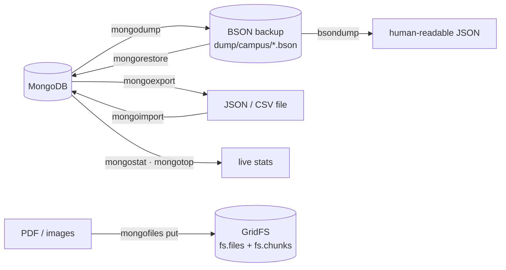

# Session 10 · MongoDB Tools

> **Module:** Managing Large Datasets using MongoDB · **Term 1** · ⏱️ ~2 hours
> **You will learn:** the MongoDB Database Tools and when to use each — **mongodump / mongorestore** (binary BSON backups), **mongoexport / mongoimport** (JSON/CSV exchange), **bsondump** (inspect BSON files), **mongostat / mongotop** (live monitoring), **mongofiles** (GridFS for large files) — plus MongoDB Compass and mongosh, Extended JSON, and how to script the same tasks in Python.

---

## 1. Moving, backing up and watching data

Day-to-day database work is not only queries: you back up before an upgrade, import a CSV from the accounts office, export a report for Excel, check why the server is slow, or store scanned admission forms. MongoDB ships a separate **Database Tools** package of command-line programs for exactly these jobs.

> 📒 **Analogy:** If MongoDB is a warehouse, `mongodump` is the photocopy of every register kept in a safe, `mongoexport` is a printed list for the accountant, `mongoimport` is the delivery van unloading new stock, and `mongostat` is the CCTV screen showing how busy each door is.



## 2. Reference tables

| Tool | Purpose | Example |
|---|---|---|
| `mongodump` | binary backup of a db/collection (keeps BSON types, indexes metadata) | `mongodump --uri="mongodb://localhost:27017" --db=campus --out=dump/` |
| `mongorestore` | restore a dump | `mongorestore --uri=... --drop dump/` |
| `mongoexport` | export to JSON (lines/array) or CSV | `mongoexport --db=campus --collection=students --type=csv --fields=name,city,marks.python --out=students.csv` |
| `mongoimport` | import JSON/CSV/TSV | `mongoimport --db=campus --collection=leads --type=csv --headerline --file=leads.csv` |
| `bsondump` | print a `.bson` file as JSON | `bsondump dump/campus/students.bson` |
| `mongostat` | per-second inserts/queries/updates, memory, connections | `mongostat --uri=... 5` |
| `mongotop` | time spent reading/writing per collection | `mongotop 10` |
| `mongofiles` | put/get/list files in GridFS | `mongofiles --db=campus put admission_form.pdf` |
| Compass (GUI) | browse, query, aggregation builder, schema view, explain plans | — |
| mongosh | interactive JavaScript shell | `mongosh "mongodb://localhost:27017/campus"` |

| Format | Keeps types? | Good for |
|---|---|---|
| BSON dump | ✅ all (dates, ObjectId, Decimal128) | backups, moving between servers |
| Extended JSON (canonical) | ✅ via `{"$date": ...}`, `{"$oid": ...}` | exchange between MongoDB tools/apps |
| relaxed JSON | mostly | readable exports |
| CSV | ❌ (everything is text; nested fields flattened) | Excel, reporting |

| Backup strategy | Notes |
|---|---|
| `mongodump` | simple; fine for small/medium databases; use `--oplog` on replica sets for a consistent point in time |
| filesystem snapshots | fast for large data; needs journaling / coordinated snapshot |
| Atlas cloud backups | continuous, point-in-time restore (Session 11) |

> 🧪 The Database Tools need a running server, so the session code reproduces each job in Python: a **real `.bson` dump file** written with `bson.encode` (readable by `bsondump`/`mongorestore`), Extended JSON export/import with `bson.json_util`, CSV export/import with pandas, and a tiny GridFS-style chunker. On a real server you can also use `gridfs.GridFS(db)`.

## 3. Worked examples

Full runnable code: [`code/examples.py`](./code/examples.py) · helpers: [`code/tools_py.py`](./code/tools_py.py) · notebook: [`notebook.ipynb`](./notebook.ipynb)

### Example 1 — dump a collection to BSON and restore it
```python
dump_collection(db.students, "output/dump/campus/students.bson")
restore_collection(db_new.students, "output/dump/campus/students.bson")
```

### Example 2 — Extended JSON keeps types
```python
from bson import json_util
text = json_util.dumps(db.students.find_one({"student_id": 1}), json_options=json_util.CANONICAL_JSON_OPTIONS)
# ... "enrolled": {"$date": {"$numberLong": "1768003200000"}} ...
```

### Example 3 — export to CSV for Excel
```python
export_csv(db.students, "output/students.csv", fields=["name", "city", "marks.python", "marks.sql"])
```

### Example 4 — import a CSV with type conversion
```python
import_csv(db.leads, "output/leads.csv", types={"age": int, "fee_offered": float})
```

### Example 5 — store a large file in chunks (GridFS idea)
```python
file_id = put_file(db, "admission_form.pdf", data, chunk_size=255 * 1024)
assert get_file(db, file_id) == data
```

### Example 6 — a mini "mongotop": which collections are biggest/busiest
```python
for name in db.list_collection_names():
    print(name, db[name].estimated_document_count())
```

## 4. Common mistakes

| Mistake | Fix |
|---|---|
| Backing up with `mongoexport` (CSV/JSON) | Types and indexes are lost; use `mongodump` for backups |
| Never testing restores | Restore to a test server regularly — an untested backup is not a backup |
| Importing CSV and getting numbers as strings | `mongoimport --columnsHaveTypes` / convert types in code |
| Passwords in shell history (`--password=...`) | Use a URI from an environment variable or `--config` file |
| Storing large files (> 16 MB) inside documents | Use GridFS (`mongofiles` / `gridfs`) or object storage with a link |

## 5. Real-life coding problem 🧮

**Problem:** Before upgrading the campus server, the admin must (1) back up every collection of the `campus` database to `output/backup/<date>/` as `.bson` files plus a `manifest.json` with document counts, (2) restore the backup into a fresh database and **verify** counts and a checksum of every document, and (3) export a CSV of students with average marks for the principal. Write `backup(db, folder)`, `restore(db, folder)` and `verify(src, dst)`.

<details>
<summary>💡 Full solution</summary>

```python
def backup(db, folder):
    folder.mkdir(parents=True, exist_ok=True)
    manifest = {}
    for name in sorted(db.list_collection_names()):
        manifest[name] = dump_collection(db[name], folder / f"{name}.bson")
    (folder / "manifest.json").write_text(json.dumps(manifest, indent=2))
    return manifest

def restore(db, folder):
    manifest = json.loads((folder / "manifest.json").read_text())
    for name in manifest:
        db[name].drop()
        restore_collection(db[name], folder / f"{name}.bson")
    return manifest

def checksum(coll):
    return hashlib.sha256(b"".join(sorted(bson.encode(d) for d in coll.find()))).hexdigest()

def verify(src, dst):
    return all(src[n].count_documents({}) == dst[n].count_documents({}) and checksum(src[n]) == checksum(dst[n])
               for n in src.list_collection_names())
```
Full file: [`code/problem_solution.py`](./code/problem_solution.py)
</details>

## 6. Practice exercises

1. Write the shell commands to dump only the `payments` collection and restore it into a database called `campus_test`.
2. Export students to JSON Lines with Extended JSON and re-import; check the `enrolled` field is still a `datetime`.
3. Export `name, batch, marks.stats` to CSV and open it with pandas; what type is `marks.stats`?
4. Split a 1 MB byte string into GridFS-style chunks of 255 KB; how many chunks?

<details>
<summary>✅ Solutions</summary>

```bash
mongodump --db=campus --collection=payments --out=dump/
mongorestore --nsFrom="campus.payments" --nsTo="campus_test.payments" dump/
```
```python
export_jsonl(db.students, p); import_jsonl(db2.students, p)
isinstance(db2.students.find_one()["enrolled"], datetime)      # True

pd.read_csv(csv_path)["marks.stats"].dtype                     # int64 (pandas re-infers numbers)

math.ceil(1_000_000 / (255 * 1024))                            # 4
```
File: [`code/exercises_solutions.py`](./code/exercises_solutions.py)
</details>

## 7. Quiz

1. Which tool should you use for a full backup that preserves BSON types?
2. What is the difference between `mongoexport` and `mongodump`?
3. Which tool shows per-collection read/write time?
4. What is GridFS for?
5. Why use Extended JSON instead of plain JSON?

<details>
<summary>Answers</summary>

1. `mongodump` (restore with `mongorestore`) · 2. `mongoexport` writes JSON/CSV for exchange and loses some types and all index definitions; `mongodump` writes binary BSON for faithful backups · 3. `mongotop` · 4. Storing files larger than 16 MB (or many binary files) by splitting them into chunks in `fs.chunks` with metadata in `fs.files` · 5. It represents BSON types (dates, ObjectId, Decimal128, int64) unambiguously so they survive the round trip.
</details>

## 8. Summary

- `mongodump`/`mongorestore` for backups; `mongoexport`/`mongoimport` for exchanging JSON/CSV.
- `bsondump`, `mongostat`, `mongotop`, `mongofiles` and Compass cover inspection, monitoring and files.
- Extended JSON preserves types; CSV doesn't.
- Automate backups, keep a manifest, and **test restores** with verification.

---
[⬅ Session 09](../Session-09-transactions/) · [Module home](../README.md) · [Session 11 ➡](../Session-11-mongodb-cloud/)

<sub>Original teaching material by Aseef Ahmed · not official Aptech courseware · CC BY-NC 4.0 (text) / MIT (code)</sub>
