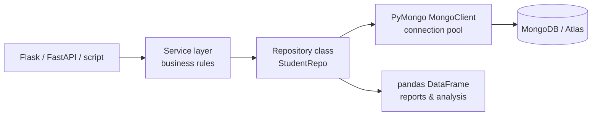

# Session 12 · MongoDB Database Connectivity with Python

> **Module:** Managing Large Datasets using MongoDB · **Term 1** · ⏱️ ~2 hours
> **You will learn:** building real Python applications on MongoDB with **PyMongo** — `MongoClient` options and connection pooling, CRUD and result objects, `ObjectId` handling, error handling (`DuplicateKeyError`, `ServerSelectionTimeoutError`), a clean **repository class** (data-access layer), creating indexes from code, batch processing with generators, aggregation results into **pandas**, and the async option (`AsyncMongoClient` / Motor).

---

## 1. From shell commands to an application

So far you have explored MongoDB interactively. Real systems — a student portal, a delivery app, a data pipeline — talk to MongoDB from code. **PyMongo** is the official Python driver: it manages connections, converts Python `dict`s to BSON and back, and exposes the same operations you learned in the shell (in `snake_case`).

> 📒 **Analogy:** PyMongo is the *rickshaw driver who knows every street*: your program says "take this order to the `orders` collection" and the driver handles the route (connection pool), traffic (retries) and the address format (BSON).



## 2. Reference tables

| Shell (mongosh) | PyMongo |
|---|---|
| `insertOne` / `insertMany` | `insert_one` / `insert_many` → `InsertOneResult.inserted_id` / `.inserted_ids` |
| `find` / `findOne` | `find` (cursor) / `find_one` (dict or `None`) |
| `updateOne` / `updateMany` | `update_one` / `update_many` → `.matched_count`, `.modified_count`, `.upserted_id` |
| `deleteOne` / `deleteMany` | `delete_one` / `delete_many` → `.deleted_count` |
| `countDocuments` | `count_documents` |
| `createIndex` | `create_index` |
| `aggregate` | `aggregate` (cursor of dicts) |
| `ObjectId("...")` | `from bson import ObjectId; ObjectId("...")` |

| `MongoClient` option | Purpose |
|---|---|
| `serverSelectionTimeoutMS=5000` | fail fast if the server is unreachable |
| `maxPoolSize=50` | connections kept in the pool (create **one client per app** and reuse it) |
| `retryWrites=True` | automatically retry a write once after a network blip |
| `w="majority"` | durable writes (Session 08) |
| `tz_aware=True` | return `datetime` objects with timezone info |
| `appName="campus-portal"` | shows up in server logs / Atlas monitoring |

| Exception (`pymongo.errors`) | When |
|---|---|
| `ServerSelectionTimeoutError` | no server reachable (wrong URI, IP not allowed, server down) |
| `DuplicateKeyError` | unique index violated |
| `BulkWriteError` | errors during `insert_many`/`bulk_write` |
| `OperationFailure` | server rejected the command (auth, bad operator, validation) |
| `bson.errors.InvalidId` | `ObjectId("not-an-id")` |

```python
# typical application setup (real server / Atlas)
import os
from pymongo import MongoClient
client = MongoClient(os.environ["MONGO_URI"], serverSelectionTimeoutMS=5000, appName="campus-portal")
db = client.get_database("campus")
client.admin.command("ping")          # verify at start-up
```

> 🧪 As in every session of this module, [`code/mongo_conn.py`](./code/mongo_conn.py) returns a mongomock client by default and a real `MongoClient` when `MONGO_URI` is set — the repository code below is identical in both cases.

## 3. Worked examples

Full runnable code: [`code/examples.py`](./code/examples.py) · repository class: [`code/student_repo.py`](./code/student_repo.py) · notebook: [`notebook.ipynb`](./notebook.ipynb)

### Example 1 — results objects
```python
r = db.students.insert_one({"name": "Iqra Shah", "batch": "DS-02"})
print(r.inserted_id)
u = db.students.update_many({"batch": "DS-02"}, {"$set": {"room": 2}})
print(u.matched_count, u.modified_count)
```

### Example 2 — ObjectId round trip (e.g. from a URL)
```python
from bson import ObjectId
from bson.errors import InvalidId
def get_by_id(text):
    try:
        return db.students.find_one({"_id": ObjectId(text)})
    except InvalidId:
        return None
```

### Example 3 — a repository class
```python
repo = StudentRepo(db)
sid = repo.add(Student(name="Danish Ali", batch="AI-01", city="Karachi", marks={"python": 74}))
repo.add_skill(sid, "mongodb"); repo.top(batch="AI-01", n=3)
```

### Example 4 — handling errors
```python
try:
    repo.add(Student(name="Danish Ali", batch="AI-01", city="Karachi", roll_no="AI-01-0001"))
except DuplicateKeyError:
    print("roll number already used")
```

### Example 5 — batch processing with a generator
```python
def batches(cursor, size=500):
    batch = []
    for doc in cursor:
        batch.append(doc)
        if len(batch) == size:
            yield batch; batch = []
    if batch:
        yield batch
```

### Example 6 — aggregation straight into pandas
```python
df = pd.DataFrame(db.students.aggregate([{"$group": {"_id": "$batch", "avg_python": {"$avg": "$marks.python"}}}]))
```

## 4. Common mistakes

| Mistake | Fix |
|---|---|
| Creating a new `MongoClient` for every request | Create one client at start-up and reuse it (it is thread-safe and pooled) |
| Comparing `_id` with a string | Convert with `ObjectId(text)` (and handle `InvalidId`) |
| Returning raw documents to a JSON API | Convert `ObjectId`/`datetime` (`str()`, `isoformat()` or `bson.json_util`) |
| Loading a huge cursor with `list()` | Iterate or process in batches |
| Swallowing every exception | Catch specific `pymongo.errors` and log the rest |

## 5. Real-life coding problem 🧮

**Problem (capstone):** Build the data layer for a **campus attendance system**. Requirements: (1) a `CampusService` that creates needed indexes on start (`students.roll_no` unique; `attendance` on `(roll_no, date)` unique); (2) `enrol(name, batch, city)` that issues roll numbers like `DS-01-0001` atomically; (3) `mark(roll_no, date, status)` that upserts one record per student per day; (4) `monthly_report(batch, month)` returning a pandas DataFrame with each student's present days, total days and attendance %, sorted by %; (5) `at_risk(batch, month, threshold=75)` listing students below the threshold. Prove it works with a simulated month of attendance.

<details>
<summary>💡 Full solution</summary>

```python
class CampusService:
    def __init__(self, db):
        self.db = db
        db.students.create_index("roll_no", unique=True)
        db.attendance.create_index([("roll_no", 1), ("date", 1)], unique=True)

    def enrol(self, name, batch, city):
        seq = self.db.counters.find_one_and_update({"_id": batch}, {"$inc": {"seq": 1}}, upsert=True,
                                                   return_document=ReturnDocument.AFTER)["seq"]
        roll = f"{batch}-{seq:04d}"
        self.db.students.insert_one({"roll_no": roll, "name": name, "batch": batch, "city": city})
        return roll

    def mark(self, roll_no, date, status):
        self.db.attendance.update_one({"roll_no": roll_no, "date": date}, {"$set": {"status": status}}, upsert=True)

    def monthly_report(self, batch, month):
        rows = list(self.db.attendance.aggregate([
            {"$match": {"roll_no": {"$regex": f"^{batch}-"}, "date": {"$regex": f"^{month}"}}},
            {"$group": {"_id": "$roll_no", "total": {"$sum": 1},
                        "present": {"$sum": {"$cond": [{"$eq": ["$status", "present"]}, 1, 0]}}}},
            {"$lookup": {"from": "students", "localField": "_id", "foreignField": "roll_no", "as": "s"}},
            {"$unwind": "$s"},
            {"$project": {"_id": 0, "roll_no": "$_id", "name": "$s.name", "present": 1, "total": 1}},
        ]))
        df = pd.DataFrame(rows)
        df["pct"] = (100 * df["present"] / df["total"]).round(1)
        return df.sort_values(["pct", "roll_no"], ascending=[False, True]).reset_index(drop=True)

    def at_risk(self, batch, month, threshold=75):
        df = self.monthly_report(batch, month)
        return df.loc[df["pct"] < threshold, "name"].tolist()
```
Full file with a simulated month and checks: [`code/problem_solution.py`](./code/problem_solution.py)
</details>

## 6. Practice exercises

1. Insert three students and print the `inserted_ids`; then update one and print `matched_count`/`modified_count`.
2. Write `to_json_safe(doc)` that converts `ObjectId` and `datetime` values so `json.dumps` works.
3. Add a method `StudentRepo.search_city(city, page, size)` with sorting by name and pagination.
4. Use `batches()` to process 1,234 documents in groups of 500 and print the group sizes.

<details>
<summary>✅ Solutions</summary>

```python
r = db.s.insert_many([{"n": 1}, {"n": 2}, {"n": 3}]); print(r.inserted_ids)
u = db.s.update_one({"n": 2}, {"$set": {"flag": True}}); print(u.matched_count, u.modified_count)

def to_json_safe(doc):
    return {k: str(v) if isinstance(v, ObjectId) else v.isoformat() if isinstance(v, datetime) else v
            for k, v in doc.items()}

def search_city(self, city, page=1, size=10):
    return list(self.coll.find({"city": city}, {"_id": 0}).sort("name", 1).skip((page - 1) * size).limit(size))

[len(b) for b in batches(db.big.find(), 500)]          # [500, 500, 234]
```
File: [`code/exercises_solutions.py`](./code/exercises_solutions.py)
</details>

## 7. Quiz

1. Why should an application create only one `MongoClient`?
2. What does `update_one(...).modified_count == 0` with `matched_count == 1` tell you?
3. How do you query by `_id` when the id arrives as a string from a web form?
4. Which exception tells you the server could not be reached?
5. What is the benefit of a repository class?

<details>
<summary>Answers</summary>

1. The client holds a thread-safe connection pool; creating many clients wastes connections and slows the app · 2. A document matched, but the update didn't change anything (values were already the same) · 3. Convert it with `ObjectId(text)`, catching `InvalidId` · 4. `ServerSelectionTimeoutError` · 5. All database code lives in one place with clear methods, so the rest of the app doesn't depend on query details and the code is easier to test and change.
</details>

## 8. Summary

- PyMongo mirrors the shell API in `snake_case` and returns result objects you should check.
- Create one `MongoClient` with sensible options; verify with `ping` at start-up; read the URI from the environment.
- Wrap data access in a repository/service class, create indexes in code, and handle specific `pymongo.errors`.
- Stream large results in batches and send aggregation output straight into pandas for analysis.

🎓 **Module complete — and Term 1 complete!** You can now program in Python, query SQL Server, analyse and model data, reason statistically, and build applications on MongoDB. Next: **Term 2 — Artificial Intelligence**.

---
[⬅ Session 11](../Session-11-mongodb-cloud/) · [Module home](../README.md)

<sub>Original teaching material by Aseef Ahmed · not official Aptech courseware · CC BY-NC 4.0 (text) / MIT (code)</sub>
