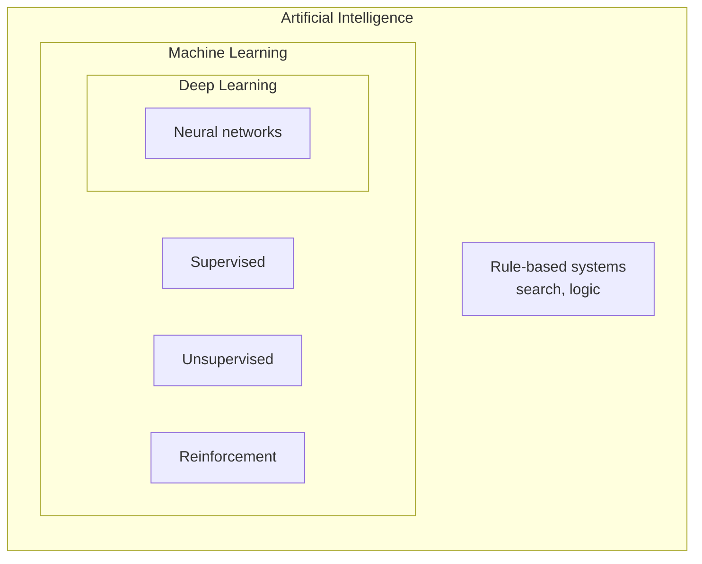
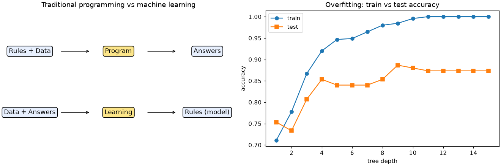

# Session 01 · Machine Learning

> **Module:** AI Primer · **Term 2** · ⏱️ ~2 hours
> **You will learn:** where machine learning sits inside AI, the three learning styles (supervised, unsupervised, reinforcement), the vocabulary of features, labels, training and testing, the standard scikit-learn workflow (`fit` → `predict` → `score`), and how to spot overfitting with a train/test split.

---

## 1. What is machine learning?

**Artificial Intelligence (AI)** is the broad goal of making machines behave intelligently. **Machine Learning (ML)** is the part of AI where the machine *learns rules from examples* instead of a programmer writing every rule by hand. **Deep Learning (DL)** is a branch of ML that uses many-layered neural networks.

> 📒 **Analogy:** A new rickshaw driver in Karachi is not handed a rulebook for every street. After hundreds of rides he *learns* that Shahrah-e-Faisal is jammed at 6 pm and the Lyari route is quicker on Fridays. Traditional programming is the rulebook; machine learning is the driver learning from experience.





## 2. Reference tables

| Learning style | Data you have | Goal | Example |
|---|---|---|---|
| Supervised | inputs **and** correct answers (labels) | predict the label for new inputs | will this student pass? (classification) · house price (regression) |
| Unsupervised | inputs only | find structure | group shoppers into segments |
| Reinforcement | an environment + rewards | learn actions that maximise reward | a robot learning to walk, a game bot |

| Term | Meaning | In scikit-learn |
|---|---|---|
| feature | an input column | `X` (2-D: rows × columns) |
| label / target | the answer column | `y` (1-D) |
| model | the learned function | `LogisticRegression()`, `DecisionTreeClassifier()` … |
| training | learning parameters from data | `model.fit(X_train, y_train)` |
| prediction | applying the model | `model.predict(X_new)` |
| evaluation | measuring quality on unseen data | `model.score(X_test, y_test)` |
| overfitting | memorising training data, failing on new data | train score ≫ test score |

| Traditional programming | Machine learning |
|---|---|
| rules + data → answers | data + answers → rules |
| programmer writes `if marks >= 50` | algorithm finds the threshold |
| breaks when the world changes | retrain on new data |

## 3. Worked examples

Full runnable code: [`code/examples.py`](./code/examples.py) · notebook: [`notebook.ipynb`](./notebook.ipynb)

### Example 1 — a hand-written rule vs a learned rule
```python
def rule_based(hours):            # programmer guesses the cut-off
    return int(hours >= 5)
tree = DecisionTreeClassifier(max_depth=1).fit(hours.reshape(-1, 1), passed)
print(tree.tree_.threshold[0])    # the cut-off the data suggests
```

### Example 2 — supervised classification workflow
```python
X, y = load_iris(return_X_y=True)
X_tr, X_te, y_tr, y_te = train_test_split(X, y, test_size=0.25, random_state=0, stratify=y)
model = LogisticRegression(max_iter=500).fit(X_tr, y_tr)
print(model.score(X_te, y_te))
```

### Example 3 — supervised regression
```python
X, y = make_regression(n_samples=200, n_features=1, noise=10, random_state=1)
reg = LinearRegression().fit(X, y)
print(reg.coef_, reg.intercept_)
```

### Example 4 — unsupervised clustering
```python
X, _ = make_blobs(n_samples=300, centers=3, random_state=2)
labels = KMeans(n_clusters=3, n_init=10, random_state=0).fit_predict(X)
```

### Example 5 — spotting overfitting
```python
for depth in [1, 3, None]:
    t = DecisionTreeClassifier(max_depth=depth, random_state=0).fit(X_tr, y_tr)
    print(depth, t.score(X_tr, y_tr), t.score(X_te, y_te))
```

### Example 6 — a tiny reinforcement-learning flavour (multi-armed bandit)
```python
estimates, counts = np.zeros(3), np.zeros(3)
for step in range(500):
    arm = rng.integers(3) if rng.random() < 0.1 else estimates.argmax()   # explore vs exploit
    reward = rng.normal(true_means[arm], 1)
    counts[arm] += 1
    estimates[arm] += (reward - estimates[arm]) / counts[arm]
```

## 4. Common mistakes

| Mistake | Fix |
|---|---|
| Evaluating on the same data you trained on | Always hold out a test set (`train_test_split`) |
| Passing a 1-D array as `X` | Reshape: `X.reshape(-1, 1)` — `X` must be 2-D |
| Calling every AI system "machine learning" | Rule-based and search systems are AI but do not learn |
| Forgetting `random_state` | Results change every run; fix seeds for teaching and debugging |
| Chasing 100 % training accuracy | It usually means overfitting; compare with test accuracy |

## 5. Real-life coding problem 🧮

**Problem:** A coaching centre in Gulshan wants to predict whether a student will pass the final exam from `attendance_pct`, `assignments_submitted` (out of 10) and `quiz_avg` (out of 20). Generate 400 synthetic student records with a seed, split 75/25, compare a hand-written rule (`attendance ≥ 75 and quiz_avg ≥ 10`) with a learned `DecisionTreeClassifier(max_depth=3)`, and report which one is more accurate on the test set.

<details>
<summary>💡 Full solution</summary>

```python
def rule(df):
    return ((df.attendance_pct >= 75) & (df.quiz_avg >= 10)).astype(int)

def compare(df, seed=0):
    X, y = df[FEATURES], df["passed"]
    X_tr, X_te, y_tr, y_te = train_test_split(X, y, test_size=0.25, random_state=seed, stratify=y)
    tree = DecisionTreeClassifier(max_depth=3, random_state=seed).fit(X_tr, y_tr)
    return {"rule": accuracy_score(y_te, rule(X_te)), "tree": accuracy_score(y_te, tree.predict(X_te))}
```
Full file with data generator and checks: [`code/problem_solution.py`](./code/problem_solution.py)
</details>

## 6. Practice exercises

1. Load the wine dataset (`load_wine`), split 70/30 and report the test accuracy of `KNeighborsClassifier(n_neighbors=5)`.
2. For each of these tasks, say whether it is supervised, unsupervised or reinforcement: (a) grouping news articles by topic, (b) predicting electricity bills, (c) a bot learning Ludo.
3. Fit `LinearRegression` to `y = 3x + 2` plus small noise and check that the learned slope is close to 3.
4. Show overfitting: train decision trees with depth 1…12 on `make_classification` data and find the depth with the best test score.

<details>
<summary>✅ Solutions</summary>

```python
X, y = load_wine(return_X_y=True)
X_tr, X_te, y_tr, y_te = train_test_split(X, y, test_size=0.3, random_state=0, stratify=y)
acc = KNeighborsClassifier(5).fit(X_tr, y_tr).score(X_te, y_te)

kinds = {"news topics": "unsupervised", "electricity bill": "supervised", "ludo bot": "reinforcement"}

x = rng.uniform(0, 10, 100); y = 3 * x + 2 + rng.normal(0, 0.5, 100)
slope = LinearRegression().fit(x.reshape(-1, 1), y).coef_[0]

scores = {d: DecisionTreeClassifier(max_depth=d, random_state=0).fit(Xa, ya).score(Xb, yb) for d in range(1, 13)}
best = max(scores, key=scores.get)
```
File: [`code/exercises_solutions.py`](./code/exercises_solutions.py)
</details>

## 7. Quiz

1. How does machine learning differ from traditional programming?
2. Name the three main learning styles.
3. In scikit-learn, what shape must `X` have?
4. What is overfitting and how do you detect it?
5. Is deep learning a subset of machine learning or the other way round?

<details>
<summary>Answers</summary>

1. Traditional programming writes rules by hand; ML learns rules from data and answers · 2. Supervised, unsupervised, reinforcement · 3. 2-D: samples × features · 4. The model memorises training data; training score is much higher than test score · 5. Deep learning is a subset of machine learning (which is a subset of AI).
</details>

## 8. Summary

- AI ⊃ ML ⊃ DL; ML learns rules from examples.
- Supervised learns from labels, unsupervised finds structure, reinforcement learns from rewards.
- The scikit-learn rhythm is `fit` → `predict` → `score`.
- Always judge a model on data it has not seen; a big train/test gap means overfitting.

---
[Module home](../README.md) · [Session 02 ➡](../Session-02-deep-learning/)

<sub>Original teaching material by Aseef Ahmed · not official Aptech courseware · CC BY-NC 4.0 (text) / MIT (code)</sub>
