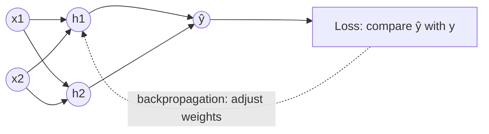
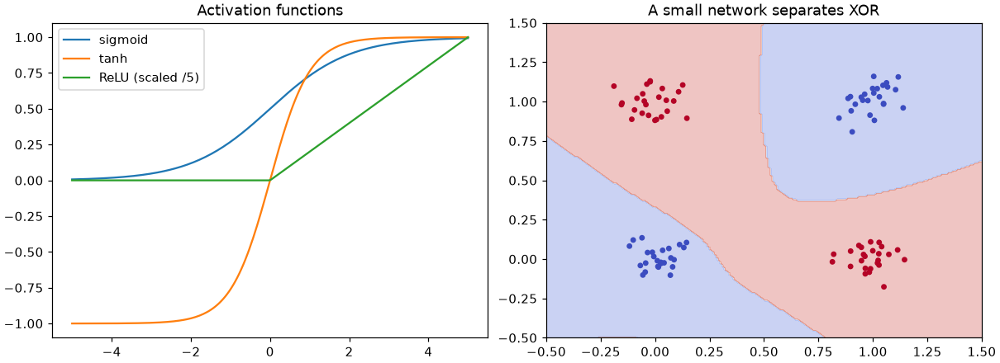

# Session 02 · Deep Learning

> **Module:** AI Primer · **Term 2** · ⏱️ ~2 hours
> **You will learn:** what makes learning "deep", the artificial neuron (weights, bias, activation), why a single neuron cannot solve XOR but two layers can, how a network learns with forward pass → loss → backpropagation → gradient descent, and how to train a small multi-layer perceptron with scikit-learn on handwritten digits.

---

## 1. From one neuron to deep networks

**Deep learning** is machine learning with **neural networks that have many layers**. Each layer turns its input into a slightly more useful representation; stacking layers lets the network learn complex patterns (edges → shapes → digits) without us hand-crafting features.

> 📒 **Analogy:** Think of a biryani taste panel. The first row of tasters each judges one thing (salt, spice, rice texture). The second row combines their notes into "balanced" or "too heavy". The head chef at the end gives the verdict. No single taster decides — the layered panel does. A neural network is that panel, and training is the chef telling each taster how much their opinion should count.





## 2. Reference tables

| Part | Formula / meaning |
|---|---|
| weighted sum | `z = w·x + b` |
| activation | `a = f(z)` — e.g. sigmoid `1/(1+e^-z)`, ReLU `max(0, z)` |
| layer | many neurons reading the same inputs |
| loss | how wrong the prediction is (e.g. cross-entropy, MSE) |
| gradient descent | `w ← w − η · ∂loss/∂w` (η = learning rate) |
| epoch | one full pass over the training data |

| Classic ML | Deep learning |
|---|---|
| you engineer features | network learns features |
| works well on small tabular data | shines on images, audio, text, large data |
| fast on CPU | often needs GPU for big models |
| easier to explain | harder to interpret |

| Tool | Use it for |
|---|---|
| `sklearn.neural_network.MLPClassifier` | small tabular / teaching networks on CPU |
| NumPy from scratch | understanding the maths |
| TensorFlow/Keras, PyTorch | real deep-learning projects (Module 04) |

## 3. Worked examples

Full runnable code: [`code/examples.py`](./code/examples.py) · notebook: [`notebook.ipynb`](./notebook.ipynb)

### Example 1 — one artificial neuron
```python
def neuron(x, w, b):
    return sigmoid(np.dot(w, x) + b)
print(neuron(np.array([1, 0]), np.array([2.0, -1.0]), -0.5))
```

### Example 2 — a single neuron learns AND but not XOR
```python
for name, y in {"AND": y_and, "XOR": y_xor}.items():
    p = Perceptron(max_iter=100, random_state=0).fit(X, y)
    print(name, p.score(X, y))      # AND 1.0, XOR ≤ 0.75
```

### Example 3 — a two-layer network from scratch solves XOR
```python
W1, b1, W2, b2 = rng.normal(size=(2, 4)), np.zeros(4), rng.normal(size=(4, 1)), np.zeros(1)
for epoch in range(5000):
    h = np.tanh(X @ W1 + b1); out = sigmoid(h @ W2 + b2)       # forward
    d_out = out - y                                           # backward
    d_h = (d_out @ W2.T) * (1 - h ** 2)
    W2 -= lr * h.T @ d_out; W1 -= lr * X.T @ d_h; b2 -= lr * d_out.sum(0); b1 -= lr * d_h.sum(0)
```

### Example 4 — gradient descent on one parameter
```python
w = 0.0
for step in range(50):
    grad = 2 * (w - 3)          # derivative of (w-3)^2
    w -= 0.1 * grad
```

### Example 5 — MLPClassifier on handwritten digits
```python
X, y = load_digits(return_X_y=True)
mlp = make_pipeline(StandardScaler(), MLPClassifier(hidden_layer_sizes=(64,), max_iter=300, random_state=0))
mlp.fit(X_tr, y_tr); print(mlp.score(X_te, y_te))
```

### Example 6 — depth vs width
```python
for layers in [(8,), (64,), (64, 32)]:
    print(layers, MLPClassifier(layers, max_iter=300, random_state=0).fit(X_tr, y_tr).score(X_te, y_te))
```

## 4. Common mistakes

| Mistake | Fix |
|---|---|
| Feeding unscaled features to a network | Scale with `StandardScaler`; networks train badly on mixed ranges |
| Learning rate too high (loss jumps around) or too low (no progress) | Try values like 0.1, 0.01, 0.001 and watch the loss |
| Using deep learning for a 200-row spreadsheet | Try a simple model first; DL needs data |
| Ignoring `ConvergenceWarning` | Increase `max_iter` or scale inputs |
| Thinking more layers is always better | Deeper nets overfit and train slower; validate |

## 5. Real-life coding problem 🧮

**Problem:** A courier company in Lahore wants to flag **late deliveries** from two signals: `distance_km` and `hour_of_day`. Lateness happens on long trips *or* at rush hour, but **not** on short off-peak trips — a non-linear pattern. Generate 600 seeded orders, then compare `LogisticRegression` with `MLPClassifier(hidden_layer_sizes=(16, 8))` on a 25 % test split and report which captures the pattern better.

<details>
<summary>💡 Full solution</summary>

```python
def make_orders(n=600, seed=3):
    rng = np.random.default_rng(seed)
    dist = rng.uniform(1, 30, n); hour = rng.uniform(8, 22, n)
    rush = ((hour > 17) & (hour < 20)) | ((hour > 8) & (hour < 10))
    late = ((dist > 20) ^ rush).astype(int)
    flip = rng.random(n) < 0.05
    return np.column_stack([dist, hour]), np.where(flip, 1 - late, late)

models = {"logistic": LogisticRegression(),
          "mlp": MLPClassifier((16, 8), max_iter=2000, random_state=0)}
scores = {k: make_pipeline(StandardScaler(), m).fit(X_tr, y_tr).score(X_te, y_te) for k, m in models.items()}
```
Full file: [`code/problem_solution.py`](./code/problem_solution.py)
</details>

## 6. Practice exercises

1. Write `relu(z)` and `sigmoid(z)` in NumPy and evaluate both at `z = [-2, 0, 2]`.
2. Use gradient descent to find the minimum of `f(w) = (w + 1)^2 + 4` starting from `w = 5`.
3. Train `MLPClassifier` on `make_moons(noise=0.2)` and compare its test accuracy with `LogisticRegression`.
4. Train `MLPClassifier` on digits with `hidden_layer_sizes=(32,)` and print the number of weights in each layer (`coefs_`).

<details>
<summary>✅ Solutions</summary>

```python
relu = lambda z: np.maximum(0, z); sigmoid = lambda z: 1 / (1 + np.exp(-z))
w = 5.0
for _ in range(100): w -= 0.1 * 2 * (w + 1)
X, y = make_moons(500, noise=0.2, random_state=0)
mlp = MLPClassifier((16, 16), max_iter=2000, random_state=0).fit(X_tr, y_tr)
shapes = [c.shape for c in MLPClassifier((32,), max_iter=300).fit(Xd, yd).coefs_]   # [(64, 32), (32, 10)]
```
File: [`code/exercises_solutions.py`](./code/exercises_solutions.py)
</details>

## 7. Quiz

1. What makes a neural network "deep"?
2. What three things does a neuron compute with?
3. Why can a single perceptron not solve XOR?
4. What does backpropagation compute?
5. Give one situation where classic ML beats deep learning.

<details>
<summary>Answers</summary>

1. Several hidden layers between input and output · 2. Weights, a bias and an activation function · 3. XOR is not linearly separable and one neuron draws a single straight line · 4. The gradient of the loss with respect to every weight, layer by layer from output to input · 5. Small tabular datasets where interpretability and speed matter.
</details>

## 8. Summary

- A neuron = weighted sum + bias + activation; layers of neurons form a network.
- Hidden layers let networks learn non-linear patterns like XOR.
- Training loops: forward pass → loss → backpropagation → gradient-descent update.
- Use `MLPClassifier` for small experiments; Module 04 goes deeper with Keras/PyTorch.

---
[⬅ Session 01](../Session-01-machine-learning/) · [Module home](../README.md) · [Session 03 ➡](../Session-03-problem-solving/)

<sub>Original teaching material by Aseef Ahmed · not official Aptech courseware · CC BY-NC 4.0 (text) / MIT (code)</sub>
