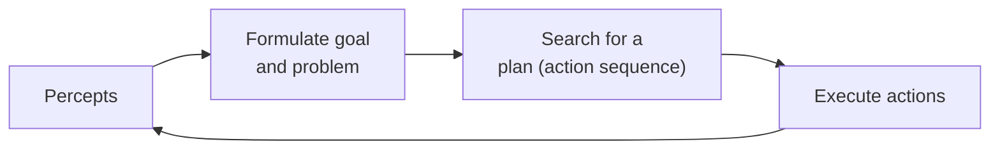

# Session 03 · Introduction to Problem Solving

> **Module:** AI Primer · **Term 2** · ⏱️ ~2 hours
> **You will learn:** what an intelligent agent is (PEAS), how to **formulate a problem** as initial state, actions, transition model, goal test and path cost, how a state space grows, and how to code a problem class in Python that any search algorithm can solve — with the water-jug and 8-puzzle problems as examples.

---

## 1. Agents and problems

An **agent** perceives its environment through sensors and acts on it through actuators. A **problem-solving agent** decides what to do by first describing its situation precisely and then searching for a sequence of actions that reaches a goal.

> 📒 **Analogy:** Planning a trip from Karachi to Hunza is problem solving. The *initial state* is "at home in Karachi", the *actions* are "take a flight", "take the Karakoram Highway bus", the *goal* is "in Karimabad", and the *path cost* is money and hours. Before you book anything you have, in your head, formulated a search problem.



## 2. Reference tables

**PEAS** describes an agent's task environment:

| Agent | Performance | Environment | Actuators | Sensors |
|---|---|---|---|---|
| Ride-hailing dispatcher | short pickup time, fair fares | city roads, riders, drivers | assign driver, set fare | GPS, ride requests |
| Exam-timetable planner | no clashes, rooms used well | courses, rooms, teachers | place exam in slot | enrolment lists |
| Robot vacuum | clean floor, low battery use | rooms, dirt, furniture | wheels, brush | bump sensor, dirt sensor |

**Five parts of a problem formulation:**

| Part | Question it answers | Water-jug example (4 L and 3 L jugs, want 2 L) |
|---|---|---|
| Initial state | where do we start? | `(0, 0)` |
| Actions(s) | what can we do here? | fill, empty, pour A→B, pour B→A |
| Result(s, a) | what happens? | e.g. fill A: `(0,0) → (4,0)` |
| Goal test | are we done? | either jug holds 2 L |
| Path cost | how expensive? | 1 per action |

| Environment property | Options |
|---|---|
| Observable | fully / partially |
| Deterministic | deterministic / stochastic |
| Episodic | episodic / sequential |
| Static | static / dynamic |
| Discrete | discrete / continuous |

## 3. Worked examples

Full runnable code: [`code/examples.py`](./code/examples.py) · notebook: [`notebook.ipynb`](./notebook.ipynb)

### Example 1 — a reusable `Problem` base class
```python
class Problem:
    def __init__(self, initial, goal=None): self.initial, self.goal = initial, goal
    def actions(self, state): raise NotImplementedError
    def result(self, state, action): raise NotImplementedError
    def is_goal(self, state): return state == self.goal
    def action_cost(self, s, a, s2): return 1
```

### Example 2 — the water-jug problem
```python
class WaterJug(Problem):
    def actions(self, s):
        return ["fill A", "fill B", "empty A", "empty B", "pour A->B", "pour B->A"]
    def result(self, s, a):
        A, B = s
        if a == "pour A->B": t = min(A, self.cap[1] - B); return (A - t, B + t)
        ...
    def is_goal(self, s): return self.target in s
```

### Example 3 — exploring the state space
```python
reachable = explore(WaterJug())     # every state reachable from (0, 0)
print(len(reachable), sorted(reachable))
```

### Example 4 — the 8-puzzle formulation
```python
class EightPuzzle(Problem):          # state = tuple of 9, 0 is the blank
    def actions(self, s):
        r, c = divmod(s.index(0), 3)
        return [m for m, ok in [("U", r > 0), ("D", r < 2), ("L", c > 0), ("R", c < 2)] if ok]
```

### Example 5 — checking a plan
```python
plan = ["fill A", "pour A->B", "empty B", "pour A->B", "fill A", "pour A->B"]
print(run_plan(WaterJug(), plan))   # ends with 2 L in jug A
```

### Example 6 — how fast state spaces grow
```python
for n in [3, 4, 5]: print(n * n - 1, "puzzle:", math.factorial(n * n) // 2, "reachable states")
```

## 4. Common mistakes

| Mistake | Fix |
|---|---|
| Storing states as lists (unhashable) | Use tuples so states fit in sets/dicts |
| Mutating the state inside `result` | Always build and return a new state |
| Forgetting illegal actions (pouring into a full jug) | Filter in `actions()` or make `result` a no-op and skip it |
| Vague goal ("good timetable") | Write a precise, testable `is_goal` |
| Mixing the search algorithm into the problem | Keep the problem class separate so any search can reuse it |

## 5. Real-life coding problem 🧮

**Problem:** A Rawalpindi warehouse has three shelves and a robot arm that can move the **top box** of one shelf onto another shelf (a small "blocks-world" problem). Boxes are labelled `A`, `B`, `C`. Formulate the problem as a `Problem` subclass with states as tuples of tuples, list all reachable states from `(("A","B","C"), (), ())` and verify that the goal `((), (), ("A","B","C"))` is reachable. Report how many states exist.

<details>
<summary>💡 Full solution</summary>

```python
class Shelves(Problem):
    def actions(self, s):
        return [(i, j) for i in range(3) for j in range(3) if i != j and s[i]]
    def result(self, s, a):
        i, j = a
        shelves = [list(x) for x in s]
        shelves[j].append(shelves[i].pop())
        return tuple(tuple(x) for x in shelves)
```
Full file: [`code/problem_solution.py`](./code/problem_solution.py)
</details>

## 6. Practice exercises

1. Write PEAS for an automated tutor that recommends practice questions.
2. Change `WaterJug` to jugs of 5 L and 3 L with target 4 L and count reachable states.
3. Add a `heuristic` method to `EightPuzzle` that counts misplaced tiles (ignore the blank).
4. Classify a chess game with a clock along the five environment properties.

<details>
<summary>✅ Solutions</summary>

```python
peas = {"P": "student marks improve", "E": "students, question bank", "A": "show question", "S": "answers, time taken"}
n = len(explore(WaterJug(caps=(5, 3), target=4)))
def misplaced(s, goal): return sum(1 for a, b in zip(s, goal) if a and a != b)
chess = {"observable": "fully", "deterministic": "deterministic", "episodic": "sequential",
         "static": "semi-dynamic", "discrete": "discrete"}
```
File: [`code/exercises_solutions.py`](./code/exercises_solutions.py)
</details>

## 7. Quiz

1. Name the five parts of a problem formulation.
2. What does PEAS stand for?
3. Why must states be hashable in Python?
4. Is a taxi-driving environment deterministic? Why?
5. How many reachable states does the 8-puzzle have?

<details>
<summary>Answers</summary>

1. Initial state, actions, transition model (result), goal test, path cost · 2. Performance, Environment, Actuators, Sensors · 3. Search algorithms store visited states in sets/dicts · 4. No — traffic and pedestrians make outcomes uncertain (stochastic) · 5. 9!/2 = 181,440.
</details>

## 8. Summary

- A problem-solving agent formulates a goal and a problem, searches, then acts.
- Every problem needs an initial state, actions, a result function, a goal test and costs.
- PEAS and environment properties tell you how hard the task is.
- Keep problem classes separate from search code — next session plugs in search.

---
[⬅ Session 02](../Session-02-deep-learning/) · [Module home](../README.md) · [Session 04 ➡](../Session-04-search-agents/)

<sub>Original teaching material by Aseef Ahmed · not official Aptech courseware · CC BY-NC 4.0 (text) / MIT (code)</sub>
