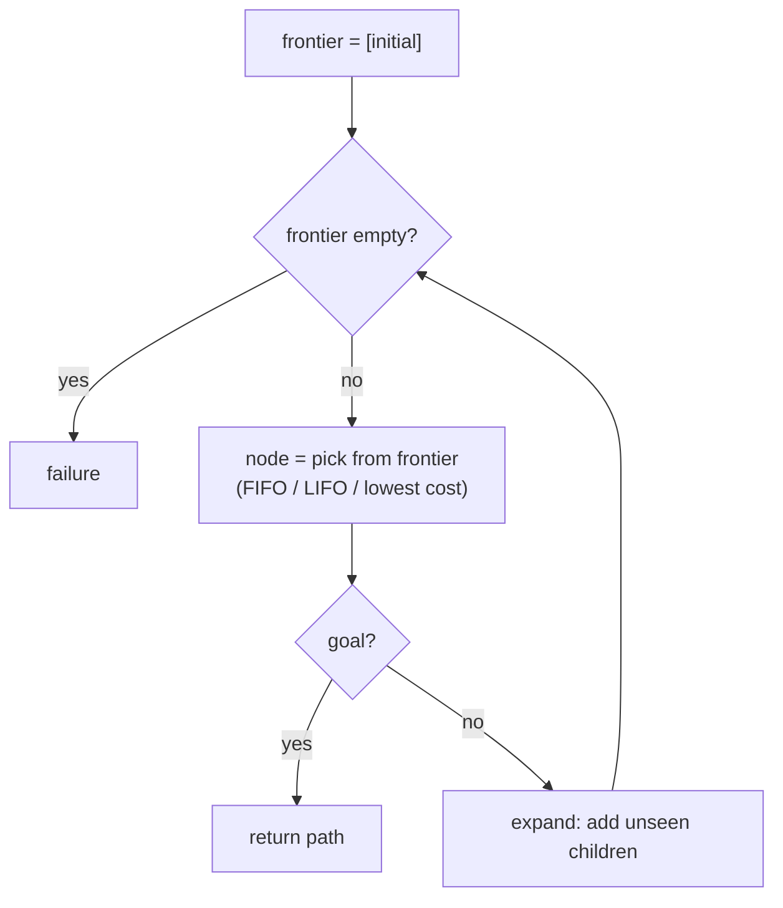
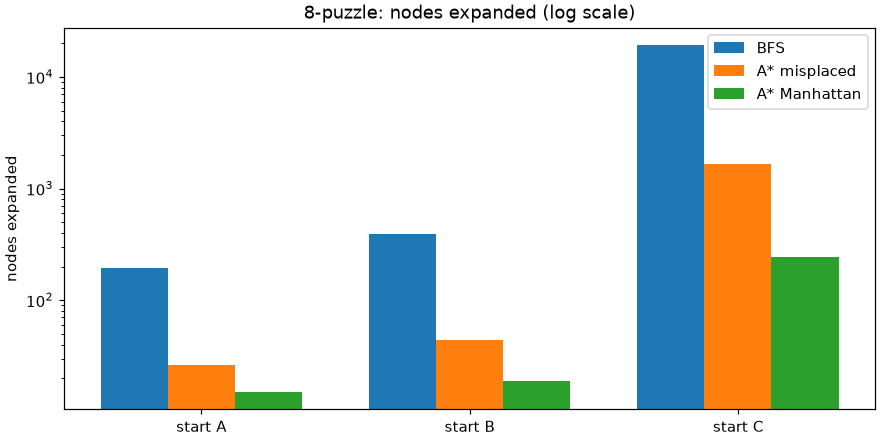

# Session 04 · Search as a Universal Problem-Solving Agent

> **Module:** AI Primer · **Term 2** · ⏱️ ~2 hours
> **You will learn:** the generic search loop (frontier + explored set), **uninformed** search (BFS, DFS, uniform-cost), **informed** search (greedy best-first, A*) with heuristics, how to judge algorithms by completeness, optimality, time and space, and how one search function solves route-finding, water jugs and the 8-puzzle.

---

## 1. One loop, many problems

Last session we wrote problems as classes. A **search agent** solves *any* such problem with the same loop: keep a **frontier** of paths still to try, pick one, check the goal, expand it, repeat. What changes between algorithms is only **which path you pick next**.

> 📒 **Analogy:** Looking for a lost cat in your mohalla. BFS asks every house on your street, then the next street — thorough but slow. DFS follows one lane to the very end before backtracking. A* is the smart neighbour who checks the houses nearest to where the cat was *last seen* first, while still counting how far you have walked.





## 2. Reference tables

| Algorithm | Frontier picks | Complete? | Optimal? | Time / space |
|---|---|---|---|---|
| Breadth-first (BFS) | oldest (FIFO queue) | yes | yes if all step costs equal | O(b^d) / O(b^d) |
| Depth-first (DFS) | newest (LIFO stack) | no on infinite/looping spaces | no | O(b^m) / O(bm) |
| Uniform-cost (UCS) | lowest path cost g(n) | yes | yes | depends on costs |
| Greedy best-first | lowest heuristic h(n) | no | no | often fast |
| A* | lowest f(n) = g(n) + h(n) | yes | yes if h is admissible | usually far fewer nodes |

*b* = branching factor, *d* = depth of shallowest goal, *m* = maximum depth.

| Heuristic idea | Problem | Admissible? |
|---|---|---|
| straight-line distance | road maps | yes (roads are never shorter than a straight line) |
| misplaced tiles | 8-puzzle | yes |
| Manhattan distance of tiles | 8-puzzle | yes, and stronger than misplaced |

## 3. Worked examples

Full runnable code: [`code/examples.py`](./code/examples.py) · notebook: [`notebook.ipynb`](./notebook.ipynb) · search library: [`code/search.py`](./code/search.py)

### Example 1 — BFS on the water-jug problem
```python
node = breadth_first(WaterJug())
print(node.path_actions())        # shortest plan to get 2 L
```

### Example 2 — a road map as a problem (approximate km, for teaching)
```python
ROADS = {("Karachi", "Hyderabad"): 165, ("Hyderabad", "Sukkur"): 320, ("Sukkur", "Multan"): 450, ...}
route = RouteProblem("Karachi", "Islamabad", ROADS, COORDS)
```

### Example 3 — UCS finds the cheapest route
```python
node = uniform_cost(route)
print(node.path_states(), node.path_cost)
```

### Example 4 — A* with a straight-line heuristic
```python
node = astar(route, h=route.h)
print(node.path_states(), node.path_cost, "nodes expanded:", stats["expanded"])
```

### Example 5 — DFS can return a long, non-optimal path
```python
node = depth_first(route); print(node.path_cost)
```

### Example 6 — A* on the 8-puzzle: misplaced vs Manhattan
```python
for h in (misplaced, manhattan):
    stats = {}; node = astar(EightPuzzle(start), h=h, stats=stats)
    print(h.__name__, len(node.path_actions()), stats["expanded"])
```

## 4. Common mistakes

| Mistake | Fix |
|---|---|
| No explored set → infinite loops on graphs | Track reached states (`reached` dict) |
| Testing the goal when a node is generated in UCS/A* | Test when it is popped, otherwise optimality breaks |
| Using a heuristic that overestimates | Keep h admissible (never more than true cost) for optimal A* |
| Using DFS when the shortest plan matters | Use BFS (equal costs) or UCS/A* |
| Forgetting tie-breaks in `heapq` (comparing nodes crashes) | Push `(priority, counter, node)` tuples |

## 5. Real-life coding problem 🧮

**Problem:** A food-delivery rider in a grid-shaped housing society must go from the restaurant at `(0, 0)` to a customer at `(7, 6)` on an 8×8 block map. Some blocks are under construction (walls). Moving one block costs 1 minute, but blocks on the main boulevard (column 3) cost only 0.5 minute because traffic flows fast. Use A* with a Manhattan-distance heuristic scaled by 0.5 (so it stays admissible) to find the fastest route, and compare the nodes expanded with UCS. Why is the saving small here?

<details>
<summary>💡 Full solution</summary>

```python
class GridRoute(Problem):
    def actions(self, s):
        x, y = s
        steps = [(x + 1, y), (x - 1, y), (x, y + 1), (x, y - 1)]
        return [p for p in steps if 0 <= p[0] < 8 and 0 <= p[1] < 8 and p not in self.walls]
    def result(self, s, a): return a
    def action_cost(self, s, a, s2): return 0.5 if s2[0] == 3 else 1.0
    def h(self, node): return 0.5 * (abs(node.state[0] - self.goal[0]) + abs(node.state[1] - self.goal[1]))
```
The heuristic must be scaled by 0.5 to stay admissible (boulevard steps cost 0.5), which makes it weak — so A* expands no more (here, the same number of) nodes than UCS while returning the same optimal cost.

Full file: [`code/problem_solution.py`](./code/problem_solution.py)
</details>

## 6. Practice exercises

1. Run BFS on `WaterJug(caps=(5, 3), target=4)` and print the plan.
2. Add Quetta to the road map (Sukkur–Quetta ≈ 390 km) and find the cheapest Karachi→Quetta route with UCS.
3. Compare greedy best-first and A* on the Peshawar→Karachi route and on the 8-puzzle start from Example 6. Where does greedy lose?
4. Count nodes expanded by BFS vs A* (Manhattan) for an 8-puzzle start that is 12 moves from the goal.

<details>
<summary>✅ Solutions</summary>

```python
plan = breadth_first(WaterJug((5, 3), 4)).path_actions()
roads = dict(ROADS); roads[("Sukkur", "Quetta")] = 390
cost = uniform_cost(RouteProblem("Karachi", "Quetta", roads, COORDS)).path_cost
p = RouteProblem("Peshawar", "Karachi", ROADS, COORDS); print(greedy(p, p.h).path_cost, astar(p, p.h).path_cost)  # equal here
print(len(greedy(EightPuzzle(start6), manhattan).path_actions()))   # 62 moves vs A*'s 20
s1, s2 = {}, {}; breadth_first(EightPuzzle(start), stats=s1); astar(EightPuzzle(start), manhattan, stats=s2)
```
File: [`code/exercises_solutions.py`](./code/exercises_solutions.py)
</details>

## 7. Quiz

1. What single thing distinguishes BFS, DFS and UCS?
2. What is f(n) in A*?
3. When is a heuristic admissible?
4. Why is DFS memory-efficient but risky?
5. Which 8-puzzle heuristic dominates: misplaced tiles or Manhattan distance?

<details>
<summary>Answers</summary>

1. The order in which nodes are taken from the frontier · 2. f(n) = g(n) (cost so far) + h(n) (estimated cost to goal) · 3. When it never overestimates the true cost to reach the goal · 4. It stores only one path, but can go down very deep or looping branches and miss shorter solutions · 5. Manhattan distance — it is always ≥ misplaced tiles and still admissible.
</details>

## 8. Summary

- Search = frontier + reached set + a rule for choosing the next node.
- BFS/UCS are complete and optimal (under their conditions); DFS saves memory but not time or quality.
- Heuristics turn blind search into informed search; A* is optimal with an admissible h.
- A good heuristic can cut expanded nodes by orders of magnitude.

---
[⬅ Session 03](../Session-03-problem-solving/) · [Module home](../README.md) · [Session 05 ➡](../Session-05-knowledge-representation/)

<sub>Original teaching material by Aseef Ahmed · not official Aptech courseware · CC BY-NC 4.0 (text) / MIT (code)</sub>
