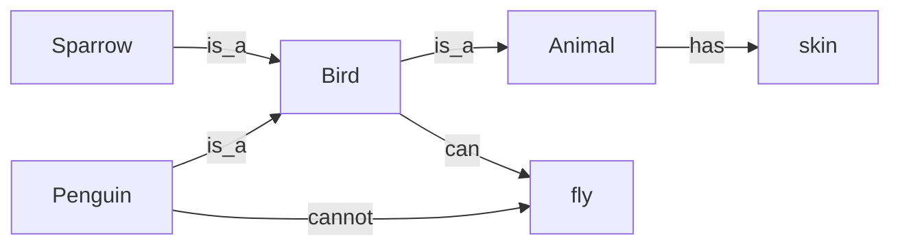

# Session 05 · Knowledge Representation

> **Module:** AI Primer · **Term 2** · ⏱️ ~2 hours
> **You will learn:** why an AI system needs explicit knowledge, the main representation schemes — **facts as triples**, **semantic networks** with inheritance, **frames** with slots and defaults, **production rules**, and **ontologies** — and how to build and query a small knowledge base in plain Python.

---

## 1. Knowledge an agent can use

Search needs a problem description; learning needs data. Many tasks also need **knowledge**: facts and relationships the agent can store, query and reason over. **Knowledge representation (KR)** is the art of writing that knowledge in a form a program can use.

> 📒 **Analogy:** A family elder at a wedding knows that Ali is Sara's cousin, cousins are invited to the mehndi, and anyone from the groom's side sits on the left. Nobody wrote a seating algorithm — the elder reasons from facts and rules in memory. KR is how we give a program that elder's memory.



## 2. Reference tables

| Scheme | Unit of knowledge | Strength | Weakness |
|---|---|---|---|
| Triples (subject, predicate, object) | `("Karachi", "capital_of", "Sindh")` | simple, queryable, basis of RDF / knowledge graphs | no built-in rules |
| Semantic network | nodes + labelled edges | inheritance along `is_a` | exceptions need care |
| Frames | object with slots, defaults, parent | natural for "typical" objects | less formal |
| Production rules | `IF conditions THEN conclusion` | easy for experts to read | large rule sets conflict |
| Logic | sentences with exact meaning | sound inference (Session 06) | can be hard to scale |
| Ontology | classes, properties, constraints | shared vocabulary across systems | effort to design |

| Good KR is … | Meaning |
|---|---|
| expressive | can say what the domain needs |
| efficient | queries and inference are fast enough |
| understandable | humans can read and maintain it |
| extensible | new facts don't break old ones |

## 3. Worked examples

Full runnable code: [`code/examples.py`](./code/examples.py) · notebook: [`notebook.ipynb`](./notebook.ipynb) · library: [`code/kb.py`](./code/kb.py)

### Example 1 — a triple store
```python
kb = TripleStore()
kb.add("Karachi", "located_in", "Sindh"); kb.add("Sindh", "located_in", "Pakistan")
print(kb.query(None, "located_in", "Sindh"))      # who is in Sindh?
```

### Example 2 — transitive queries
```python
print(kb.transitive("Karachi", "located_in"))      # {'Sindh', 'Pakistan'}
```

### Example 3 — semantic network with inheritance and exceptions
```python
net.add_isa("penguin", "bird"); net.set("bird", "can_fly", True); net.set("penguin", "can_fly", False)
print(net.get("sparrow", "can_fly"), net.get("penguin", "can_fly"))   # True False
```

### Example 4 — frames with slots and defaults
```python
course = Frame("Course", hours=36, mode="on-campus")
ai_primer = Frame("AI Primer", parent=course, hours=14)
print(ai_primer["hours"], ai_primer["mode"])       # 14 on-campus (inherited)
```

### Example 5 — production rules with forward chaining
```python
rules = [({"fever", "cough"}, "flu_suspected"), ({"flu_suspected", "short_breath"}, "see_doctor")]
print(forward_chain({"fever", "cough", "short_breath"}, rules))
```

### Example 6 — a tiny ontology check
```python
onto = {"Student": "Person", "Faculty": "Person", "Person": "Thing"}
print(is_subclass("Student", "Thing", onto))
```

## 4. Common mistakes

| Mistake | Fix |
|---|---|
| Mixing instances and classes (`Ali is_a Student` vs `Student is_a Person`) | Use `instance_of` for objects and `is_a`/`subclass_of` for classes |
| Inheriting a default and ignoring exceptions | Look up the most specific node first, then climb |
| Free-text predicates (`"lives in"`, `"livesIn"`, `"city"`) | Fix a vocabulary (ontology) and stick to it |
| Cycles in `is_a` links | Check for cycles when adding; use a visited set when climbing |
| Rules that fire forever | Only add a conclusion if it is new; stop when nothing changes |

## 5. Real-life coding problem 🧮

**Problem:** A university help-desk bot must answer "Can student X sit the final exam?". Knowledge: students belong to batches, batches belong to programmes, each programme has a minimum attendance (default 75 % from a `Programme` frame, but `Diploma-AI` overrides it to 80 %), and a rule says *eligible if attendance ≥ minimum and fees_cleared*. Build the knowledge base with triples + frames + one rule and answer for three students.

<details>
<summary>💡 Full solution</summary>

```python
def min_attendance(student):
    batch = kb.one(student, "in_batch"); programme = kb.one(batch, "of_programme")
    return FRAMES[programme]["min_attendance"]

def eligible(student):
    att = kb.one(student, "attendance"); fees = kb.one(student, "fees_cleared")
    return att >= min_attendance(student) and fees
```
Full file: [`code/problem_solution.py`](./code/problem_solution.py)
</details>

## 6. Practice exercises

1. Add five Pakistani cities with `located_in` triples and list every place inside Punjab.
2. Extend the semantic net so that `ostrich` cannot fly but `eagle` can; query both.
3. Create a `Vehicle` frame (wheels=4) and `Rickshaw` child (wheels=3); print both wheel counts.
4. Add a rule `({"see_doctor", "age_over_60"}, "urgent")` and show which facts are derived.

<details>
<summary>✅ Solutions</summary>

```python
for c in ["Lahore", "Multan", "Faisalabad"]: kb.add(c, "located_in", "Punjab")
inside = kb.query(None, "located_in", "Punjab")
net.add_isa("ostrich", "bird"); net.set("ostrich", "can_fly", False); net.add_isa("eagle", "bird")
rickshaw = Frame("Rickshaw", parent=Frame("Vehicle", wheels=4), wheels=3)
facts = forward_chain({"fever", "cough", "short_breath", "age_over_60"}, rules + [({"see_doctor", "age_over_60"}, "urgent")])
```
File: [`code/exercises_solutions.py`](./code/exercises_solutions.py)
</details>

## 7. Quiz

1. What are the three parts of a triple?
2. How does inheritance work in a semantic network?
3. What does a frame slot "default" mean?
4. What is forward chaining?
5. Why do systems share an ontology?

<details>
<summary>Answers</summary>

1. Subject, predicate, object · 2. A node takes a property from its `is_a` ancestors unless it has its own value · 3. The value used when a child frame does not specify its own · 4. Repeatedly firing rules whose conditions are satisfied to add new facts until nothing changes · 5. So they use the same meaning for the same terms and can exchange knowledge.
</details>

## 8. Summary

- Knowledge representation makes facts and relationships usable by programs.
- Triples and semantic networks store relations; frames capture typical objects with defaults.
- Production rules turn facts into new facts; ontologies fix a shared vocabulary.
- Choose the scheme that balances expressiveness, efficiency and readability.

---
[⬅ Session 04](../Session-04-search-agents/) · [Module home](../README.md) · [Session 06 ➡](../Session-06-logical-reasoning/)

<sub>Original teaching material by Aseef Ahmed · not official Aptech courseware · CC BY-NC 4.0 (text) / MIT (code)</sub>
