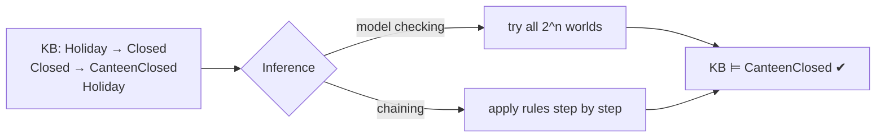
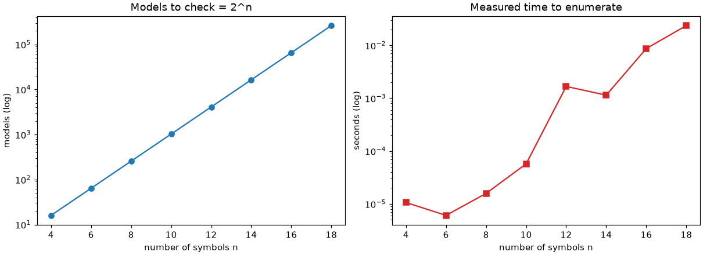

# Session 06 · Logical Reasoning in AI and Performance Computation

> **Module:** AI Primer · **Term 2** · ⏱️ ~2 hours
> **You will learn:** propositional logic (symbols, connectives, truth tables), **entailment** and how to check it by enumerating models, inference rules such as modus ponens, **forward and backward chaining** over Horn clauses, and how to **compute performance** of reasoning methods and agents — counting steps, timing code, and scoring decisions with accuracy, precision and recall.

---

## 1. Reasoning with logic

A knowledge base (KB) written in **logic** lets an agent derive conclusions that are *guaranteed* to be true whenever the KB is true. We say the KB **entails** α (written KB ⊨ α) if α is true in every world (model) where the KB is true.

> 📒 **Analogy:** The college gate guard knows: "If it is a public holiday, the college is closed" and "If the college is closed, the canteen is closed". Told "Today is 14 August", he concludes the canteen is closed — without checking it. Logical inference is that chain of certain conclusions.





## 2. Reference tables

| Connective | Symbol | Python | True when |
|---|---|---|---|
| not | ¬P | `not P` | P is false |
| and | P ∧ Q | `P and Q` | both true |
| or | P ∨ Q | `P or Q` | at least one true |
| implies | P → Q | `(not P) or Q` | false only when P true and Q false |
| iff | P ↔ Q | `P == Q` | same truth value |

| Inference rule | From | Conclude |
|---|---|---|
| Modus ponens | P → Q, P | Q |
| Modus tollens | P → Q, ¬Q | ¬P |
| And-elimination | P ∧ Q | P |
| Resolution | P ∨ Q, ¬Q ∨ R | P ∨ R |

| Method | Idea | Cost |
|---|---|---|
| Model checking (truth table) | test every assignment | 2ⁿ models for n symbols — exponential |
| Forward chaining | fire rules from known facts (data-driven) | linear in KB size for Horn clauses |
| Backward chaining | start from the query, prove sub-goals (goal-driven) | only touches relevant rules |

| Performance measure | Formula |
|---|---|
| accuracy | correct / total |
| precision | TP / (TP + FP) |
| recall | TP / (TP + FN) |
| runtime | `time.perf_counter()` before and after |
| work done | count of models checked / rules fired |

## 3. Worked examples

Full runnable code: [`code/examples.py`](./code/examples.py) · notebook: [`notebook.ipynb`](./notebook.ipynb) · library: [`code/logic.py`](./code/logic.py)

### Example 1 — truth table for implication
```python
for P, Q in itertools.product([True, False], repeat=2):
    print(P, Q, implies(P, Q))
```

### Example 2 — entailment by model checking
```python
kb = lambda m: implies(m["Holiday"], m["Closed"]) and implies(m["Closed"], m["Canteen"]) and m["Holiday"]
print(entails(kb, lambda m: m["Canteen"], ["Holiday", "Closed", "Canteen"]))   # True
```

### Example 3 — validity and satisfiability
```python
print(is_valid(lambda m: m["P"] or not m["P"], ["P"]))       # tautology
print(is_satisfiable(lambda m: m["P"] and not m["P"], ["P"]))  # contradiction → False
```

### Example 4 — forward chaining over Horn clauses
```python
rules = [(["Holiday"], "Closed"), (["Closed"], "Canteen"), (["Rain", "Closed"], "StayHome")]
derived, fired = forward_chain(rules, {"Holiday"})
```

### Example 5 — backward chaining with a step counter
```python
ok, steps = backward_chain(rules, {"Holiday"}, "Canteen")
```

### Example 6 — performance computation: models vs symbols, and timing
```python
for n in [4, 8, 12, 16]:
    t0 = time.perf_counter(); count_models(n); print(n, 2 ** n, time.perf_counter() - t0)
```

## 4. Common mistakes

| Mistake | Fix |
|---|---|
| Reading P → Q as "Q → P" | Implication is one-way; check with a truth table |
| Thinking P → Q is false when P is false | It is *true* (vacuously) when P is false |
| Using model checking with 40 symbols | 2⁴⁰ worlds is impossible; use chaining or SAT solvers |
| Judging a reasoner only by accuracy on imbalanced cases | Report precision and recall too |
| Timing code once | Repeat and take the median or best (`timeit`) |

## 5. Real-life coding problem 🧮

**Problem:** A bank branch in Saddar uses a rule-based **loan-screening agent**: `salaried ∧ good_credit → low_risk`, `low_risk ∧ income_ok → approve`, `defaulted → high_risk`, `high_risk → reject`. Encode the rules as Horn clauses, run the agent on 200 seeded applicants (whose true outcome comes from a hidden noisy policy), and compute the agent's **accuracy, precision and recall** for "approve", plus the average number of rules fired per applicant.

<details>
<summary>💡 Full solution</summary>

```python
RULES = [(["salaried", "good_credit"], "low_risk"), (["low_risk", "income_ok"], "approve"),
         (["defaulted"], "high_risk"), (["high_risk"], "reject")]

def decide(applicant):
    facts = {k for k, v in applicant.items() if v}
    derived, fired = forward_chain(RULES, facts)
    return int("approve" in derived and "reject" not in derived), fired
```
Full file: [`code/problem_solution.py`](./code/problem_solution.py)
</details>

## 6. Practice exercises

1. Print the truth table of `(P ∧ Q) → P` and say whether it is valid.
2. Check whether `{P → Q, ¬Q} ⊨ ¬P` (modus tollens) by model checking.
3. Show that forward chaining fires *more* rules than backward chaining needs when the KB has many irrelevant rules.
4. Time `entails` for 10, 14 and 18 symbols and estimate how long 30 symbols would take.

<details>
<summary>✅ Solutions</summary>

```python
valid = is_valid(lambda m: implies(m["P"] and m["Q"], m["P"]), ["P", "Q"])
mt = entails(lambda m: implies(m["P"], m["Q"]) and not m["Q"], lambda m: not m["P"], ["P", "Q"])
_, fired = forward_chain(big_rules, {"A"}); _, steps = backward_chain(big_rules, {"A"}, "C")
est_30 = t18 * 2 ** (30 - 18)
```
File: [`code/exercises_solutions.py`](./code/exercises_solutions.py)
</details>

## 7. Quiz

1. What does KB ⊨ α mean?
2. When is P → Q false?
3. Why is truth-table model checking expensive?
4. How do forward and backward chaining differ?
5. What does recall measure for an "approve" decision?

<details>
<summary>Answers</summary>

1. α is true in every model in which the KB is true · 2. Only when P is true and Q is false · 3. It checks 2ⁿ models — doubling with every extra symbol · 4. Forward starts from facts and derives everything; backward starts from the query and only proves what it needs · 5. Of all applicants who truly should be approved, the share the agent approved.
</details>

## 8. Summary

- Propositional logic gives exact meaning; entailment means "true in every model of the KB".
- Model checking is simple but exponential; chaining over Horn clauses is efficient.
- Forward chaining is data-driven, backward chaining is goal-driven.
- Measure reasoners and agents: count work, time it, and score decisions with accuracy, precision and recall.

---
[⬅ Session 05](../Session-05-knowledge-representation/) · [Module home](../README.md) · [Session 07 ➡](../Session-07-openai-coding/)

<sub>Original teaching material by Aseef Ahmed · not official Aptech courseware · CC BY-NC 4.0 (text) / MIT (code)</sub>
