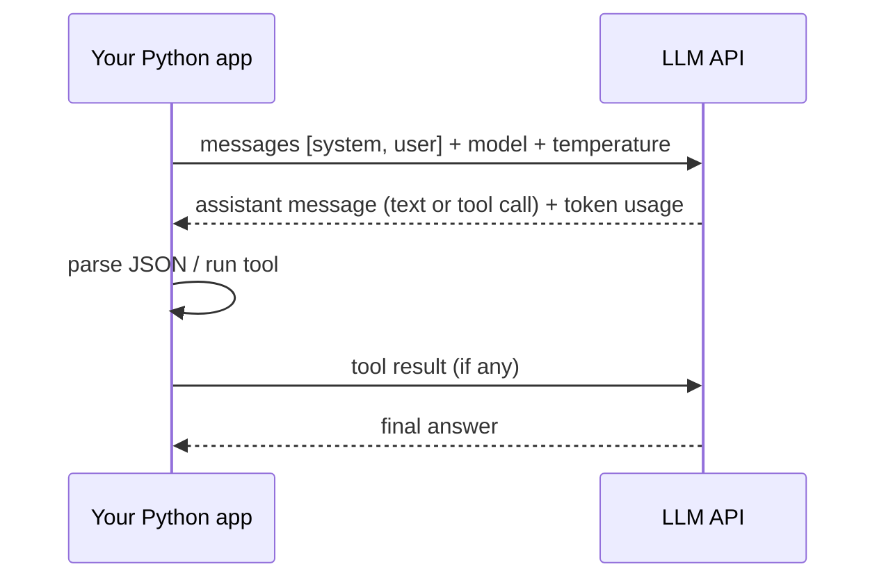

# Session 07 · OpenAI Coding in Python

> **Module:** AI Primer · **Term 2** · ⏱️ ~2 hours
> **You will learn:** how large-language-model (LLM) APIs work (messages, roles, tokens, temperature), how to call the OpenAI Python SDK safely (API key in an environment variable, never in code), how to get **structured JSON** back, how **tool / function calling** works, how to estimate cost, retry on errors, and how to ground answers in your own data — all with an offline stand-in client so every example runs without a key.

---

## 1. Talking to an LLM from code

An LLM API takes a list of **messages** and returns the model's next message. Your program decides what goes in (instructions, user question, context documents) and what to do with the reply (show it, parse it as JSON, call a function).

> 📒 **Analogy:** Calling an LLM API is like sending a WhatsApp voice note to a very well-read assistant in another city. You must give clear instructions (system message), the question (user message) and any papers they need (context) — they can't see your desk. Each message costs a little credit (tokens), and sometimes the network fails and you resend.



## 2. Reference tables

| Concept | Meaning |
|---|---|
| `system` message | rules and persona for the model |
| `user` message | the question or task |
| `assistant` message | the model's reply (keep it in history for multi-turn chat) |
| token | a word piece (~¾ of an English word); you pay per input + output token |
| temperature | 0 = focused/repeatable, higher = more varied |
| `response_format={"type": "json_object"}` | ask for valid JSON output |
| tools | functions the model may ask your code to run |

| Real SDK call (needs `pip install openai` and `OPENAI_API_KEY`) |
|---|
| `from openai import OpenAI` · `client = OpenAI()` (reads the key from the environment) |
| `r = client.chat.completions.create(model=MODEL, messages=[...], temperature=0)` |
| `r.choices[0].message.content` · `r.usage.prompt_tokens`, `r.usage.completion_tokens` |

| Safety rule | Why |
|---|---|
| Key in env var / `.env`, never in the notebook | keys leaked to GitHub get abused within minutes |
| Validate model output before using it | models can return wrong or malformed answers |
| Don't send private student data unless allowed | privacy and policy |
| Set timeouts and retries | networks fail; rate limits happen |

In this session `code/llm_client.py` returns the **real** OpenAI client when `OPENAI_API_KEY` is set and the `openai` package is installed, and otherwise an **offline fake** with the same `client.chat.completions.create(...)` shape, so the code is identical either way. The model name comes from the `OPENAI_MODEL` environment variable — check the provider's docs for current model names.

## 3. Worked examples

Full runnable code: [`code/examples.py`](./code/examples.py) · notebook: [`notebook.ipynb`](./notebook.ipynb) · client: [`code/llm_client.py`](./code/llm_client.py)

### Example 1 — a first chat completion
```python
client, MODEL = get_client()
r = client.chat.completions.create(model=MODEL, temperature=0, messages=[
    {"role": "system", "content": "You are a concise tutor."},
    {"role": "user", "content": "Define machine learning in one sentence."}])
print(r.choices[0].message.content, r.usage.total_tokens)
```

### Example 2 — multi-turn chat keeps history
```python
history = [{"role": "system", "content": "You are a helpful tutor."}]
for q in ["What is BFS?", "And DFS?"]:
    history.append({"role": "user", "content": q})
    reply = client.chat.completions.create(model=MODEL, messages=history).choices[0].message.content
    history.append({"role": "assistant", "content": reply})
```

### Example 3 — structured JSON output
```python
r = client.chat.completions.create(model=MODEL, response_format={"type": "json_object"}, messages=[
    {"role": "system", "content": "Reply as JSON with keys sentiment and score."},
    {"role": "user", "content": "The lab session was excellent!"}])
data = json.loads(r.choices[0].message.content)
```

### Example 4 — tool (function) calling
```python
tools = [{"type": "function", "function": {"name": "get_fee", "parameters": {...}}}]
msg = client.chat.completions.create(model=MODEL, messages=msgs, tools=tools).choices[0].message
if msg.tool_calls:
    args = json.loads(msg.tool_calls[0].function.arguments); result = get_fee(**args)
```

### Example 5 — estimating tokens and cost
```python
tokens = estimate_tokens(prompt)               # ≈ len(text) / 4 for English
cost = tokens / 1_000_000 * PRICE_PER_MILLION   # look up current prices
```

### Example 6 — retries with exponential back-off
```python
def with_retry(fn, tries=4):
    for i in range(tries):
        try: return fn()
        except TransientError: time.sleep(0.01 * 2 ** i)
```

## 4. Common mistakes

| Mistake | Fix |
|---|---|
| Hard-coding the API key | `os.environ["OPENAI_API_KEY"]`, add `.env` to `.gitignore` |
| Trusting `json.loads` on raw output | Ask for JSON mode, wrap in `try`, validate keys and types |
| Forgetting to resend history | The API is stateless — send previous messages each turn |
| High temperature for factual tasks | Use 0–0.3 for grading, extraction, classification |
| Sending a whole textbook as context | Retrieve only the relevant paragraphs (Module 06 covers RAG) |

## 5. Real-life coding problem 🧮

**Problem:** Build an **admissions FAQ assistant** for a Karachi institute. It must answer only from a small set of policy snippets (fees, timings, eligibility), return JSON `{"answer": ..., "source": ...}`, and say "Please contact the front desk" when the question is outside the snippets. Use simple keyword retrieval to pick the best snippet, put it in the prompt, call the LLM client, validate the JSON, and test it on three questions.

<details>
<summary>💡 Full solution</summary>

```python
def words(text):                      # lower-case words minus stop-words like "is", "the", "for"
    return set(re.findall(r"\w+", text.lower())) - STOP

def retrieve(question):
    q = words(question)
    scored = [(len(q & words(t)), k) for k, t in SNIPPETS.items()]
    best_score, best = max(scored)
    return (best, SNIPPETS[best]) if best_score >= 2 else (None, None)

def ask(client, model, question):
    key, text = retrieve(question)
    if key is None:
        return {"answer": "Please contact the front desk.", "source": None}
    r = client.chat.completions.create(model=model, temperature=0, response_format={"type": "json_object"},
        messages=[{"role": "system", "content": "Answer ONLY from the context. JSON keys: answer, source."},
                  {"role": "user", "content": f"Context [{key}]: {text}\nQuestion: {question}"}])
    data = json.loads(r.choices[0].message.content)
    assert set(data) == {"answer", "source"}
    return data
```
Full file: [`code/problem_solution.py`](./code/problem_solution.py)
</details>

## 6. Practice exercises

1. Write a function `summarise(text)` that asks the model for a one-line summary at temperature 0.
2. Ask for JSON with keys `topic` and `difficulty` (1–5) for a quiz question and validate the range.
3. Add a second tool `get_timing(course)` and route tool calls to the right Python function.
4. Estimate the cost of sending 500 prompts of 300 tokens each with 150-token replies at given per-million prices.

<details>
<summary>✅ Solutions</summary>

```python
def summarise(text): return chat(client, MODEL, "Summarise in one line.", text)
data = json.loads(...); assert 1 <= data["difficulty"] <= 5
TOOLS = {"get_fee": get_fee, "get_timing": get_timing}; result = TOOLS[call.function.name](**args)
cost = 500 * (300 * price_in + 150 * price_out) / 1_000_000
```
File: [`code/exercises_solutions.py`](./code/exercises_solutions.py)
</details>

## 7. Quiz

1. What is the role of the system message?
2. Why must you resend earlier messages in a chat?
3. Where should an API key live?
4. What does temperature control?
5. In tool calling, who actually runs the function?

<details>
<summary>Answers</summary>

1. It sets instructions, rules and persona for the model · 2. The API is stateless; it only sees what you send in this request · 3. In an environment variable or secrets manager, never in code or Git · 4. How random/varied the output is · 5. Your code — the model only asks for the call with arguments.
</details>

## 8. Summary

- LLM APIs take messages and return messages; you pay per token.
- Keep keys out of code, keep temperature low for factual work, validate outputs.
- JSON mode and tool calling turn free text into data and actions.
- Ground answers in your own snippets and handle out-of-scope questions honestly.

---
[⬅ Session 06](../Session-06-logical-reasoning/) · [Module home](../README.md)

<sub>Original teaching material by Aseef Ahmed · not official Aptech courseware · CC BY-NC 4.0 (text) / MIT (code)</sub>
