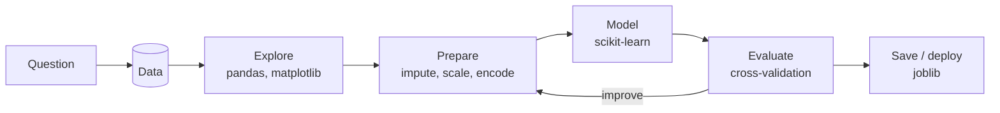

# Session 01 · Introduction to Artificial Intelligence and Machine Learning with Python

> **Module:** AI and ML with Python · **Term 2** · ⏱️ ~2 hours
> **You will learn:** the Python AI/ML toolbox (NumPy, pandas, scikit-learn, matplotlib, and where TensorFlow/PyTorch fit), the end-to-end ML workflow, the scikit-learn estimator API, building a **Pipeline** with a **ColumnTransformer** for mixed numeric and categorical data, **cross-validation**, comparing models fairly, and saving a trained model with `joblib`.

---

## 1. The ML workflow in Python

Every ML project, from a cricket-score predictor to a fraud detector, follows the same loop: **define the question → get data → explore → prepare → train → evaluate → deploy → monitor**. Python is the default language for this loop because its libraries cover every step.

> 📒 **Analogy:** Making nihari for a family dinner: buy ingredients (collect data), clean and cut them (preprocess), cook slowly (train), taste and adjust salt (evaluate and tune), then serve and see who asks for seconds (deploy and monitor). Skip the cleaning and no amount of cooking fixes it.



## 2. Reference tables

| Library | Role |
|---|---|
| NumPy | fast arrays and maths |
| pandas | tables: load, clean, group |
| matplotlib / seaborn | charts |
| scikit-learn | classic ML: preprocessing, models, evaluation |
| TensorFlow/Keras, PyTorch | deep learning (Module 04) |
| joblib | save/load trained models |

| Estimator method | Used on | Does |
|---|---|---|
| `fit(X, y)` | everything | learn from data |
| `transform(X)` | transformers (scalers, encoders) | change data |
| `fit_transform(X)` | transformers | fit then transform (training data only) |
| `predict(X)` / `predict_proba(X)` | models | labels / probabilities |
| `score(X, y)` | models | default metric (accuracy, R²) |

| Preprocessing need | Tool |
|---|---|
| missing numbers | `SimpleImputer(strategy="median")` |
| different scales | `StandardScaler()` |
| text categories | `OneHotEncoder(handle_unknown="ignore")` |
| different steps per column | `ColumnTransformer` |
| chain everything without leakage | `Pipeline` / `make_pipeline` |

## 3. Worked examples

Full runnable code: [`code/examples.py`](./code/examples.py) · notebook: [`notebook.ipynb`](./notebook.ipynb)

### Example 1 — a synthetic student dataset with mixed types
```python
df = make_students(500)          # attendance, quiz_avg, city, shift, passed (with some missing values)
df.info()
```

### Example 2 — preprocessing with ColumnTransformer
```python
pre = ColumnTransformer([
    ("num", make_pipeline(SimpleImputer(strategy="median"), StandardScaler()), NUM),
    ("cat", OneHotEncoder(handle_unknown="ignore"), CAT)])
```

### Example 3 — a full pipeline
```python
pipe = Pipeline([("pre", pre), ("model", LogisticRegression(max_iter=1000))])
pipe.fit(X_tr, y_tr); print(pipe.score(X_te, y_te))
```

### Example 4 — cross-validation
```python
scores = cross_val_score(pipe, X, y, cv=5); print(scores.mean(), scores.std())
```

### Example 5 — comparing models fairly
```python
for name, m in {"logreg": LogisticRegression(max_iter=1000), "tree": DecisionTreeClassifier(max_depth=4),
                "forest": RandomForestClassifier(200, random_state=0)}.items():
    print(name, cross_val_score(Pipeline([("pre", pre), ("model", m)]), X, y, cv=5).mean())
```

### Example 6 — save and reload with joblib
```python
joblib.dump(pipe, "output/pass_model.joblib")
loaded = joblib.load("output/pass_model.joblib"); loaded.predict(new_students)
```

## 4. Common mistakes

| Mistake | Fix |
|---|---|
| Scaling the whole dataset before splitting (data leakage) | Put the scaler inside a `Pipeline` |
| `OneHotEncoder` crashes on a new city | `handle_unknown="ignore"` |
| Judging by one lucky split | Use `cross_val_score` |
| Saving only the model, not the preprocessing | Save the whole pipeline |
| Comparing models with different preprocessing | Share one `pre` object across candidates |

## 5. Real-life coding problem 🧮

**Problem:** A mobile-phone shop chain wants to predict whether a walk-in customer will **buy on the same day**. Data (synthetic, seeded): `age`, `budget_pkr`, `brand_pref` (Samsung/Infinix/Apple/Tecno), `visited_before` (yes/no), `city`, with some missing budgets. Build a pipeline (impute + scale + one-hot), compare logistic regression and random forest with 5-fold cross-validation, retrain the winner on all data, save it, reload it and predict for two new customers.

<details>
<summary>💡 Full solution</summary>

```python
pre = ColumnTransformer([("num", make_pipeline(SimpleImputer(strategy="median"), StandardScaler()), NUM),
                         ("cat", OneHotEncoder(handle_unknown="ignore"), CAT)])
cands = {"logreg": LogisticRegression(max_iter=1000), "forest": RandomForestClassifier(200, random_state=0)}
cv = {k: cross_val_score(Pipeline([("pre", pre), ("m", m)]), X, y, cv=5).mean() for k, m in cands.items()}
best = Pipeline([("pre", pre), ("m", cands[max(cv, key=cv.get)])]).fit(X, y)
joblib.dump(best, path); print(joblib.load(path).predict_proba(new)[:, 1])
```
Full file: [`code/problem_solution.py`](./code/problem_solution.py)
</details>

## 6. Practice exercises

1. Load `load_breast_cancer(as_frame=True)` and report 5-fold CV accuracy of `make_pipeline(StandardScaler(), LogisticRegression())`.
2. Show leakage: compare CV accuracy when you scale *before* `cross_val_score` vs inside a pipeline on a dataset with an obvious leak (they will be similar on this data — explain why scaling leakage is usually small but target leakage is not).
3. Add a `KNeighborsClassifier` to the student model comparison.
4. Save a pipeline, reload it, and assert that predictions are identical.

<details>
<summary>✅ Solutions</summary>

```python
X, y = load_breast_cancer(return_X_y=True)
acc = cross_val_score(make_pipeline(StandardScaler(), LogisticRegression(max_iter=1000)), X, y, cv=5).mean()
leaky = np.column_stack([X, y + rng.normal(0, 0.01, len(y))])   # a feature built from the target
knn = cross_val_score(Pipeline([("pre", pre), ("m", KNeighborsClassifier(7))]), Xs, ys, cv=5).mean()
assert (joblib.load(p).predict(X) == pipe.predict(X)).all()
```
File: [`code/exercises_solutions.py`](./code/exercises_solutions.py)
</details>

## 7. Quiz

1. Name the four scikit-learn methods every estimator family uses.
2. Why put preprocessing inside a `Pipeline`?
3. What problem does `ColumnTransformer` solve?
4. What does 5-fold cross-validation report?
5. Why save the full pipeline with `joblib` rather than just the model?

<details>
<summary>Answers</summary>

1. `fit`, `transform`/`predict`, `fit_transform`, `score` · 2. So preprocessing is learned only on training folds (no leakage) and travels with the model · 3. Applying different preprocessing to numeric and categorical columns · 4. The mean (and spread) of scores over five train/validation splits · 5. New data must go through exactly the same preprocessing.
</details>

## 8. Summary

- Python covers the whole ML loop: pandas → scikit-learn → joblib.
- Pipelines + ColumnTransformers keep preprocessing correct and reusable.
- Cross-validation gives a fairer estimate than a single split.
- Save and version the entire pipeline.

---
[Module home](../README.md) · [Session 02 ➡](../Session-02-recommender-systems/)

<sub>Original teaching material by Aseef Ahmed · not official Aptech courseware · CC BY-NC 4.0 (text) / MIT (code)</sub>
