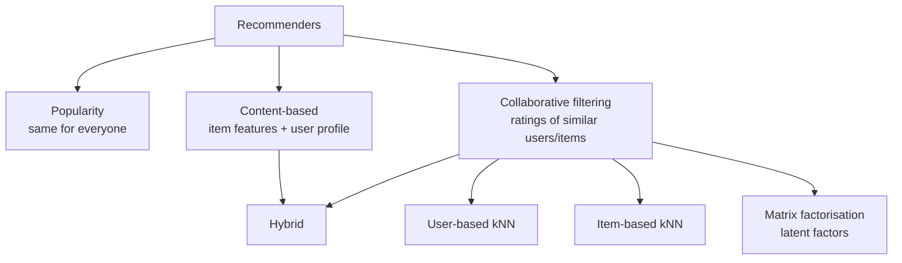
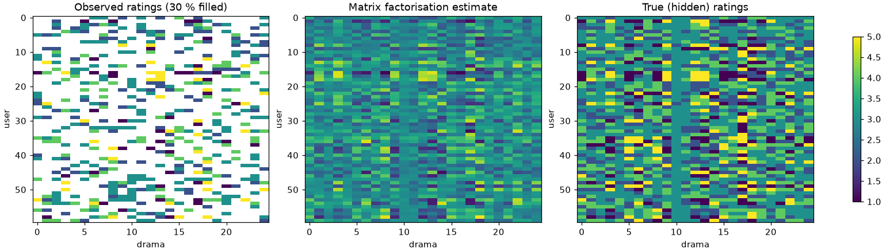

# Session 02 · Advanced Recommender Systems: Types and Implementations

> **Module:** AI and ML with Python · **Term 2** · ⏱️ ~2 hours
> **You will learn:** the main recommender families — popularity, **content-based**, **collaborative filtering** (user-based and item-based), **matrix factorisation** and **hybrids** — how to build each with NumPy/scikit-learn on a synthetic ratings matrix, and how to evaluate recommendations with RMSE and precision@k, plus the cold-start problem.

---

## 1. Why recommenders?

Daraz, YouTube and Foodpanda all show "you may also like". A **recommender system** predicts how much a user will like items they have not seen and shows the best ones. Good recommendations increase sales and engagement; bad ones annoy users.

> 📒 **Analogy:** The kitabwala at Urdu Bazaar remembers that you bought Ibn-e-Safi and suggests another detective novel (content-based). He also notices that students who bought your physics guide also bought a particular past-paper book (collaborative filtering). A modern recommender does both, for millions of customers at once.





## 2. Reference tables

| Type | Needs | Good at | Weak at |
|---|---|---|---|
| Popularity | interaction counts | new users | personalisation |
| Content-based | item features (genre, text) | new items, explainable | "more of the same" |
| User-based CF | ratings matrix | serendipity | many users = slow; sparse data |
| Item-based CF | ratings matrix | stable, scalable | new items |
| Matrix factorisation (SVD) | ratings matrix | accuracy, compact | cold start, explainability |
| Hybrid | both | best overall | complexity |

| Metric | Measures |
|---|---|
| RMSE / MAE | error of predicted ratings on held-out ratings |
| precision@k | share of top-k recommendations the user actually liked |
| recall@k | share of liked items that appear in the top-k |
| coverage | share of catalogue ever recommended |

| Similarity | Formula idea |
|---|---|
| cosine | angle between two rating/feature vectors |
| Pearson | cosine after subtracting each user's mean (removes generous/strict raters) |

## 3. Worked examples

Full runnable code: [`code/examples.py`](./code/examples.py) · notebook: [`notebook.ipynb`](./notebook.ipynb) · helpers: [`code/recsys.py`](./code/recsys.py)

### Example 1 — a synthetic ratings matrix (users × dramas)
```python
R_true, R, mask = make_ratings(n_users=60, n_items=25, k=3, density=0.3)   # 0 = not rated
```

### Example 2 — popularity baseline
```python
mean_rating = np.where(mask, R, np.nan); top = np.argsort(-np.nanmean(mean_rating, axis=0))[:5]
```

### Example 3 — content-based with TF-IDF
```python
tfidf = TfidfVectorizer().fit_transform(descriptions)
sim = cosine_similarity(tfidf); print(np.argsort(-sim[0])[1:4])    # items like item 0
```

### Example 4 — user-based collaborative filtering
```python
pred = user_knn_predict(R, mask, user=3, item=7, k=10)
```

### Example 5 — matrix factorisation by gradient descent
```python
P, Q, B = factorise(R, mask, k=3)      # B = global mean + user bias + item bias
R_hat = B + P @ Q.T
```

### Example 6 — evaluate: RMSE and precision@k
```python
print(rmse(R_test, R_hat, test_mask), precision_at_k(R_hat, R_true, mask, k=5))
```

## 4. Common mistakes

| Mistake | Fix |
|---|---|
| Treating missing ratings as 0 ("hated it") | Keep a mask; only learn from observed ratings |
| Recommending items the user already rated | Filter them out before taking top-k |
| Ignoring rater bias (some users give everything 5) | Mean-centre ratings or learn user/item biases (our `factorise` does) |
| No regularisation in MF (beats the training set, loses to the global mean on test) | Add an L2 penalty (`reg`) and check held-out RMSE |
| Evaluating on training ratings | Hold out a random subset of ratings |
| Forgetting cold start | Fall back to popularity or content for new users/items |

## 5. Real-life coding problem 🧮

**Problem:** A Pakistani streaming app has 80 users and 30 dramas, each drama tagged with genres (romance, family, thriller, comedy, historical). Ratings are sparse. Build a **hybrid recommender**: score = 0.7 × matrix-factorisation prediction + 0.3 × content similarity to the user's liked dramas. Hold out 20 % of ratings, compare RMSE of MF alone vs global mean, and show top-5 hybrid recommendations for one user and for a brand-new user (cold start → content + popularity).

<details>
<summary>💡 Full solution</summary>

```python
def hybrid_scores(user, R_hat, item_feats, R, mask, alpha=0.7):
    liked = np.where(mask[user] & (R[user] >= 4))[0]
    profile = item_feats[liked].mean(0) if len(liked) else item_feats.mean(0)
    content = cosine_similarity(profile[None], item_feats)[0] * 5
    scores = alpha * R_hat[user] + (1 - alpha) * content
    scores[mask[user]] = -np.inf          # don't recommend what they've seen
    return scores
```
Full file: [`code/problem_solution.py`](./code/problem_solution.py)
</details>

## 6. Practice exercises

1. Implement item-based CF: predict a rating as the similarity-weighted average of the user's ratings on the *k* most similar items.
2. Compare RMSE of user-based CF, item-based CF and MF on the same held-out ratings.
3. Use `TruncatedSVD` on the mean-filled matrix as a quick factorisation and report RMSE.
4. Compute catalogue coverage of top-5 recommendations for all users.

<details>
<summary>✅ Solutions</summary>

```python
pred = item_knn_predict(R, mask, user, item, k=8)
scores = {"user": rmse_of(user_knn_predict), "item": rmse_of(item_knn_predict), "mf": rmse(R, B + P @ Q.T, test)}
filled = np.where(mask, R, user_means[:, None]); svd = TruncatedSVD(3).fit(filled); R_svd = svd.inverse_transform(svd.transform(filled))
coverage = len(set(np.concatenate([top_k(R_hat, mask, u, 5) for u in range(n_users)]))) / n_items
```
File: [`code/exercises_solutions.py`](./code/exercises_solutions.py)
</details>

## 7. Quiz

1. What is the difference between content-based and collaborative filtering?
2. What is the cold-start problem?
3. Why should missing ratings not be treated as zero?
4. What do latent factors in matrix factorisation represent?
5. What does precision@5 = 0.6 mean?

<details>
<summary>Answers</summary>

1. Content-based uses item features; CF uses patterns in other users' ratings · 2. New users/items have no ratings, so CF cannot recommend for/with them · 3. Unrated does not mean disliked; zeros would bias the model downward · 4. Hidden tastes/traits (e.g. "likes family drama") learned from ratings · 5. Three of the top five recommended items were actually liked.
</details>

## 8. Summary

- Popularity → content → collaborative filtering → matrix factorisation → hybrids.
- Always mask missing ratings, remove seen items, and hold out ratings for testing.
- Measure rating error (RMSE) and ranking quality (precision@k), plus coverage.
- Hybrids and fallbacks handle cold start.

---
[⬅ Session 01](../Session-01-intro-ai-ml-python/) · [Module home](../README.md) · [Session 03 ➡](../Session-03-bayesian-networks/)

<sub>Original teaching material by Aseef Ahmed · not official Aptech courseware · CC BY-NC 4.0 (text) / MIT (code)</sub>
