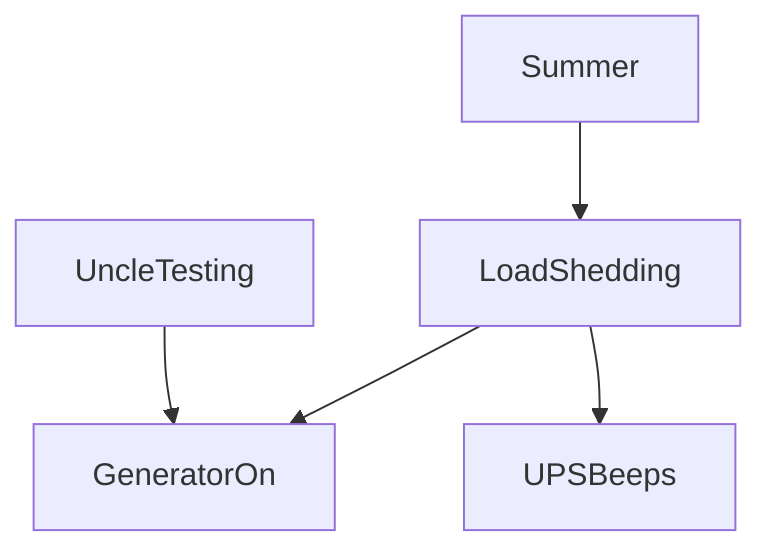
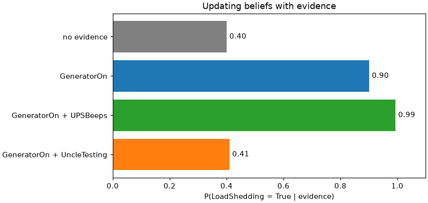

# Session 03 · Bayesian Networks and their Practical Application

> **Module:** AI and ML with Python · **Term 2** · ⏱️ ~2 hours
> **You will learn:** how a **Bayesian network** (BN) encodes uncertain knowledge as a directed acyclic graph plus **conditional probability tables (CPTs)**, how the chain rule factorises the joint distribution, how to answer queries by **exact enumeration** and by **sampling**, how to **learn CPTs from data**, and how naive Bayes is the simplest BN — all in plain Python and scikit-learn.

---

## 1. Reasoning under uncertainty

Logic (Module 01) says things are true or false. Real life is uncertain: a cough *might* mean flu, a late bus *might* mean traffic. A **Bayesian network** draws arrows from causes to effects and stores, for each node, the probability of its values given its parents. From this compact model we can compute any probability we need — including reasoning backwards from effects to causes.

> 📒 **Analogy:** You hear the generator start at night. It could be load-shedding (common in summer) or your uncle testing it (rare). The UPS beeping makes load-shedding even more likely. A BN is the family's shared intuition, written down with numbers, so a program can update its beliefs every time a new clue arrives.





## 2. Reference tables

| Concept | Meaning |
|---|---|
| node | a random variable (e.g. LoadShedding ∈ {T, F}) |
| edge A → B | A directly influences B |
| CPT | P(node \| parents) for every parent combination |
| chain rule | P(X₁…Xₙ) = Π P(Xᵢ \| Parents(Xᵢ)) |
| evidence | variables whose values we observed |
| query | P(X \| evidence) — the posterior |

| Reasoning type | Direction | Example |
|---|---|---|
| causal (predictive) | cause → effect | P(GeneratorOn \| LoadShedding) |
| diagnostic | effect → cause | P(LoadShedding \| GeneratorOn) |
| explaining away | two causes, one effect observed | learning UncleTesting=T lowers P(LoadShedding \| GeneratorOn) |

| Inference method | Exact? | Cost |
|---|---|---|
| enumeration | yes | exponential in hidden variables |
| variable elimination | yes | much less, depends on graph |
| rejection / likelihood-weighted sampling | approximate | grows with accuracy wanted |

| Bayes' rule | P(A \| B) = P(B \| A) · P(A) / P(B) |
|---|---|

## 3. Worked examples

Full runnable code: [`code/examples.py`](./code/examples.py) · notebook: [`notebook.ipynb`](./notebook.ipynb) · library: [`code/bn.py`](./code/bn.py)

### Example 1 — define the network and CPTs
```python
net = BayesNet()
net.add("Summer", [], {(): 0.4})
net.add("LoadShedding", ["Summer"], {(True,): 0.7, (False,): 0.2})
net.add("GeneratorOn", ["LoadShedding", "UncleTesting"], {(True, True): 0.99, (True, False): 0.9, ...})
```

### Example 2 — the joint probability of one full world (chain rule)
```python
print(net.joint({"Summer": True, "LoadShedding": True, "UncleTesting": False, "GeneratorOn": True, "UPSBeeps": True}))
```

### Example 3 — diagnostic query by enumeration
```python
print(net.query("LoadShedding", {"GeneratorOn": True}))
```

### Example 4 — explaining away
```python
print(net.query("LoadShedding", {"GeneratorOn": True, "UncleTesting": True}))   # lower!
```

### Example 5 — approximate inference by rejection sampling
```python
print(rejection_sample(net, "LoadShedding", {"GeneratorOn": True}, n=20000, seed=0))
```

### Example 6 — learn CPTs from data
```python
df = net.sample_df(5000, seed=1)
learned = learn_cpt(df, "GeneratorOn", ["LoadShedding", "UncleTesting"])
```

## 4. Common mistakes

| Mistake | Fix |
|---|---|
| Drawing arrows from effect to cause "because we observe the effect" | Arrows follow causation; inference can still go backwards |
| CPT rows that don't sum to 1 | Store P(True) only for binary nodes, or check sums |
| Confusing P(A \| B) with P(B \| A) | Use Bayes' rule explicitly |
| Zero counts when learning CPTs | Add Laplace smoothing (+1 to each count) |
| Enumerating huge networks | Use variable elimination or sampling |

## 5. Real-life coding problem 🧮

**Problem:** A Karachi clinic wants a small **dengue triage** BN. Nodes: `Monsoon` → `Dengue`; `Dengue` → `Fever`, `Dengue` → `LowPlatelets`; `Flu` → `Fever`. Learn all CPTs (with Laplace smoothing) from 4,000 seeded synthetic patient records, then compute P(Dengue | Fever) and P(Dengue | Fever, LowPlatelets) in monsoon season, and check the learned answers against the true network within 0.05.

<details>
<summary>💡 Full solution</summary>

```python
learned = BayesNet()
for node, parents in STRUCTURE:
    learned.add(node, parents, learn_cpt(records, node, parents, alpha=1))
p1 = learned.query("Dengue", {"Monsoon": True, "Fever": True})[True]
p2 = learned.query("Dengue", {"Monsoon": True, "Fever": True, "LowPlatelets": True})[True]
```
Full file: [`code/problem_solution.py`](./code/problem_solution.py)
</details>

## 6. Practice exercises

1. Use Bayes' rule by hand: a test is 95 % sensitive, 90 % specific, prevalence 2 %. What is P(disease | positive)? Check with code.
2. Query P(UPSBeeps | Summer=True) (causal reasoning) in the example network.
3. Show that rejection sampling's estimate gets closer to the exact answer as n grows (n = 500, 5,000, 50,000).
4. Train `CategoricalNB` on samples from the network to predict `LoadShedding` from the other four variables and report accuracy.

<details>
<summary>✅ Solutions</summary>

```python
post = 0.95 * 0.02 / (0.95 * 0.02 + 0.10 * 0.98)          # ≈ 0.162
p = net.query("UPSBeeps", {"Summer": True})[True]
errs = {n: abs(rejection_sample(net, "LoadShedding", ev, n)[True] - exact) for n in (500, 5000, 50000)}
acc = CategoricalNB().fit(X_tr, y_tr).score(X_te, y_te)
```
File: [`code/exercises_solutions.py`](./code/exercises_solutions.py)
</details>

## 7. Quiz

1. What two things define a Bayesian network?
2. Write the chain-rule factorisation for A → B → C.
3. What is "explaining away"?
4. Why is rejection sampling wasteful when evidence is rare?
5. How is naive Bayes a Bayesian network?

<details>
<summary>Answers</summary>

1. A directed acyclic graph and a CPT for each node · 2. P(A, B, C) = P(A) · P(B \| A) · P(C \| B) · 3. When an effect has two possible causes, confirming one cause lowers the probability of the other · 4. Most samples disagree with the evidence and are thrown away · 5. The class node is the single parent of every feature node, so features are independent given the class.
</details>

## 8. Summary

- A BN = DAG + CPTs; the chain rule turns them into a full joint distribution.
- Enumeration gives exact posteriors for small networks; sampling scales approximately.
- BNs support causal, diagnostic and explaining-away reasoning.
- CPTs can be learned from data by counting with smoothing; naive Bayes is the simplest BN.

---
[⬅ Session 02](../Session-02-recommender-systems/) · [Module home](../README.md) · [Session 04 ➡](../Session-04-anomaly-detection-interpretability/)

<sub>Original teaching material by Aseef Ahmed · not official Aptech courseware · CC BY-NC 4.0 (text) / MIT (code)</sub>
