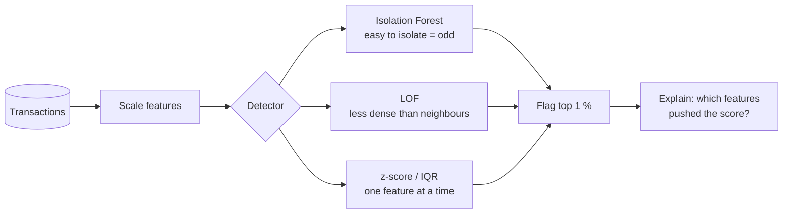
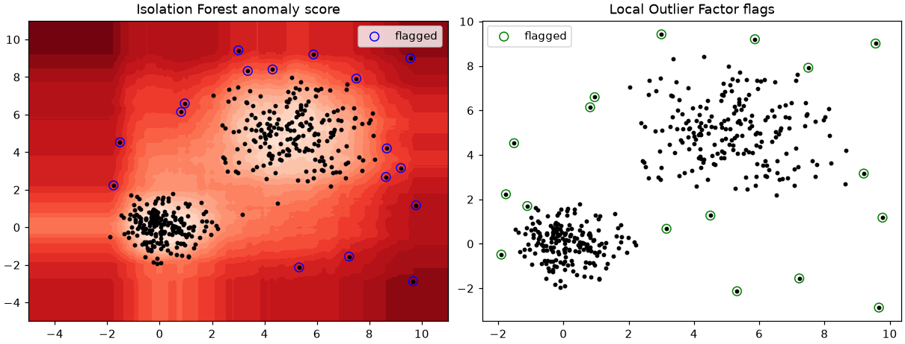

# Session 04 · Anomaly Detection and Model Interpretability

> **Module:** AI and ML with Python · **Term 2** · ⏱️ ~2 hours
> **You will learn:** what anomalies are (point, contextual, collective), statistical detectors (z-score, IQR), ML detectors (**Isolation Forest**, **Local Outlier Factor**, One-Class SVM), how to evaluate them when labels are rare, and how to **explain models** — global explanations (coefficients, **permutation importance**, **partial dependence**) and local explanations (per-prediction feature contributions).

---

## 1. Finding the odd one out — and explaining why

An **anomaly** is a data point that does not fit the usual pattern: a Rs 450,000 card payment at 3 am from a user who normally spends Rs 2,000 at lunch. Anomaly detection is usually **unsupervised** because confirmed fraud labels are rare. Once a model flags something, people need to know **why** — that is **interpretability**.

> 📒 **Analogy:** A mohalla chowkidar knows every regular face. He doesn't need a list of thieves to notice a stranger trying gate handles at 2 am (anomaly detection). When the residents ask "why did you stop him?", he says "unknown face, odd hour, checking several gates" (explanation). An AI system must do both.





## 2. Reference tables

| Detector | Idea | Key parameter | Notes |
|---|---|---|---|
| z-score | \|x − mean\| / std > 3 | threshold | one feature, assumes bell shape |
| IQR rule | outside Q1 − 1.5·IQR … Q3 + 1.5·IQR | 1.5 multiplier | robust to skew |
| `IsolationForest` | random splits isolate outliers in few steps | `contamination` | fast, works in many dimensions |
| `LocalOutlierFactor` | density lower than neighbours' | `n_neighbors` | good for local/cluster anomalies |
| `OneClassSVM` | boundary around normal data | `nu`, `gamma` | needs scaling, slower |

| Evaluating with few labels | Use |
|---|---|
| precision@k | of the top-k flagged, how many are real? (investigators' time is limited) |
| recall | how many known anomalies were caught |
| ROC-AUC / PR-AUC on anomaly scores | ranking quality; PR-AUC is better when anomalies are rare |

| Interpretability tool | Scope | scikit-learn |
|---|---|---|
| coefficients (scaled data) | global, linear models | `model.coef_` |
| feature importance (impurity) | global, trees | `model.feature_importances_` (biased to many-valued features) |
| permutation importance | global, any model | `sklearn.inspection.permutation_importance` |
| partial dependence | global shape of one feature's effect | `sklearn.inspection.partial_dependence` |
| local contribution | one prediction | linear: `coef * (x − mean)`; any model: "what-if" changes |

## 3. Worked examples

Full runnable code: [`code/examples.py`](./code/examples.py) · notebook: [`notebook.ipynb`](./notebook.ipynb)

### Example 1 — z-score and IQR on one feature
```python
z = (amount - amount.mean()) / amount.std(); z_flags = np.abs(z) > 3
q1, q3 = np.percentile(amount, [25, 75]); iqr_flags = (amount < q1 - 1.5 * (q3 - q1)) | (amount > q3 + 1.5 * (q3 - q1))
```

### Example 2 — Isolation Forest
```python
iso = IsolationForest(contamination=0.02, random_state=0).fit(X)
scores = -iso.score_samples(X)             # higher = more anomalous
```

### Example 3 — Local Outlier Factor
```python
lof = LocalOutlierFactor(n_neighbors=20, contamination=0.02)
lof_flags = lof.fit_predict(X) == -1
```

### Example 4 — evaluating with precision@k and PR-AUC
```python
print(precision_at_k(y, scores, k=20), average_precision_score(y, scores))
```

### Example 5 — permutation importance
```python
r = permutation_importance(clf, X_te, y_te, n_repeats=10, random_state=0)
```

### Example 6 — partial dependence and a local explanation
```python
pd_res = partial_dependence(clf, X_te, features=[0], grid_resolution=20)
contrib = logreg.coef_[0] * (x_scaled - 0)          # per-feature push for one case
```

## 4. Common mistakes

| Mistake | Fix |
|---|---|
| Not scaling before LOF / One-Class SVM | `StandardScaler` first — distances need comparable units |
| Setting `contamination` far from reality | Estimate the expected anomaly rate with domain experts |
| Reporting accuracy (99 % by predicting "normal") | Use precision@k, recall, PR-AUC |
| Trusting impurity importances blindly | Cross-check with permutation importance on test data |
| Explaining a model that is itself wrong | Check performance first, then explain |

## 5. Real-life coding problem 🧮

**Problem:** A Pakistani fintech app has 3,000 seeded card transactions with `amount_pkr`, `hour`, `km_from_home`, `merchant_risk` (0–1) and `tx_last_hour`; about 1.5 % are fraud (labels known only for evaluation). Use an Isolation Forest to rank transactions, report precision@30 and PR-AUC, then for the top 3 flagged transactions print a **plain-language reason**: the two features that are most unusual (largest robust z-score versus the median customer).

<details>
<summary>💡 Full solution</summary>

```python
iso = IsolationForest(n_estimators=300, contamination=0.015, random_state=0).fit(X)
scores = -iso.score_samples(X)
med = np.median(X, axis=0); mad = np.median(np.abs(X - med), axis=0) * 1.4826
def reason(row):
    rz = np.abs((row - med) / mad)
    top = np.argsort(-rz)[:2]
    return ", ".join(f"{FEATURES[i]}={row[i]:.0f} (typical {med[i]:.0f})" for i in top)
```
Full file: [`code/problem_solution.py`](./code/problem_solution.py)
</details>

## 6. Practice exercises

1. Inject 10 outliers into `make_blobs` data and compare how many each of IsolationForest, LOF and OneClassSVM catch.
2. Show the effect of `contamination` (0.01, 0.05, 0.1) on the number of flagged points.
3. Train a random forest on `load_breast_cancer` and list the top 5 features by permutation importance.
4. For a logistic-regression model on scaled breast-cancer data, print the three features that pushed one test case most towards "malignant".

<details>
<summary>✅ Solutions</summary>

```python
caught = {name: (det.fit_predict(Xo)[-10:] == -1).sum() for name, det in detectors.items()}
flags = {c: (IsolationForest(contamination=c, random_state=0).fit_predict(X) == -1).sum() for c in (0.01, 0.05, 0.1)}
imp = permutation_importance(rf, X_te, y_te, n_repeats=10, random_state=0).importances_mean
contrib = lr.coef_[0] * Xs_te[0]; top = np.argsort(contrib)[:3]   # class 0 = malignant in this dataset
```
File: [`code/exercises_solutions.py`](./code/exercises_solutions.py)
</details>

## 7. Quiz

1. Why is anomaly detection often unsupervised?
2. How does Isolation Forest decide a point is anomalous?
3. Why is accuracy a poor metric for fraud detection?
4. What does permutation importance measure?
5. What is the difference between a global and a local explanation?

<details>
<summary>Answers</summary>

1. Labelled anomalies are rare, expensive or new types appear · 2. It needs fewer random splits to isolate it (short average path length) · 3. With 1 % fraud, predicting "normal" always scores 99 % yet catches nothing · 4. How much the score drops when one feature's values are shuffled · 5. Global explains the model overall; local explains one specific prediction.
</details>

## 8. Summary

- Statistical rules work per feature; Isolation Forest and LOF handle many features.
- Evaluate detectors with precision@k / PR-AUC, not accuracy.
- Permutation importance and partial dependence explain models globally.
- Give investigators local, plain-language reasons for each flag.

---
[⬅ Session 03](../Session-03-bayesian-networks/) · [Module home](../README.md) · [Session 05 ➡](../Session-05-customer-segmentation/)

<sub>Original teaching material by Aseef Ahmed · not official Aptech courseware · CC BY-NC 4.0 (text) / MIT (code)</sub>
