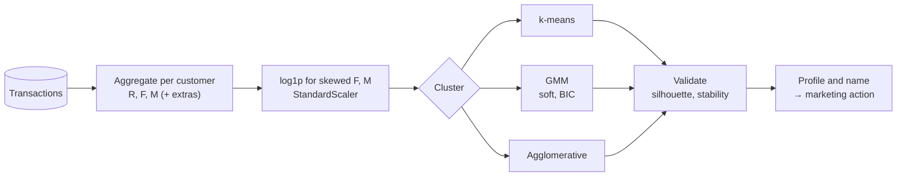
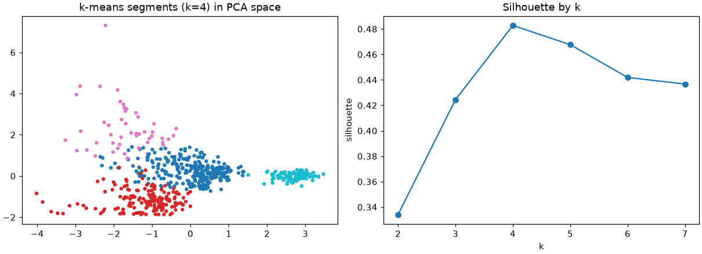

# Session 05 · Clustering Techniques for Customer Segmentation

> **Module:** AI and ML with Python · **Term 2** · ⏱️ ~2 hours
> **You will learn:** how to turn raw transactions into **RFM** (Recency, Frequency, Monetary) features, why log-transforming and scaling matter, how to segment customers with **k-means**, **Gaussian Mixture Models** (soft membership, BIC) and **agglomerative** clustering, how to visualise segments with **PCA**, how to check **cluster stability**, and how to turn clusters into named, actionable segments.

---

## 1. From transactions to segments

Term 1 introduced k-means on ready-made features. In business, you usually start from a **transactions log** (who bought what, when, for how much) and must engineer customer-level features first. The classic recipe is **RFM**:

- **Recency** — days since last purchase (lower is better)
- **Frequency** — number of orders
- **Monetary** — total spend

> 📒 **Analogy:** A shopkeeper in Tariq Road knows three kinds of regulars without any software: the aunty who comes every week and spends a lot (champion), the student who visits only during sales (bargain hunter), and the customer who used to come but hasn't been seen since Eid (at risk). RFM + clustering finds these groups across 50,000 online customers.





## 2. Reference tables

| Step | pandas / scikit-learn |
|---|---|
| RFM aggregation | `tx.groupby("customer").agg(last=("date", "max"), F=("order_id", "nunique"), M=("amount", "sum"))` |
| fix skew | `np.log1p(df[["F", "M"]])` |
| scale | `StandardScaler()` |
| k-means | `KMeans(n_clusters=k, n_init=10, random_state=0)` |
| GMM | `GaussianMixture(n_components=k, random_state=0)` → `predict_proba`, `bic(X)` |
| hierarchical | `AgglomerativeClustering(n_clusters=k, linkage="ward")` |
| 2-D view | `PCA(n_components=2).fit_transform(X)` |
| stability | `adjusted_rand_score(labels_seed0, labels_seed1)` |

| Choosing k | Rule |
|---|---|
| silhouette | pick the k with the highest average silhouette |
| BIC (GMM) | pick the k with the lowest BIC |
| business sense | segments must be large enough and actionable |

| Typical RFM segment | Profile | Action |
|---|---|---|
| Champions | low R, high F, high M | loyalty rewards, early access |
| Loyal regulars | moderate everything | cross-sell |
| Bargain hunters | buy mostly on discount | targeted sale alerts |
| At risk | high R (long ago), used to buy | win-back offer |
| New | low R, F = 1 | onboarding coupon |

## 3. Worked examples

Full runnable code: [`code/examples.py`](./code/examples.py) · notebook: [`notebook.ipynb`](./notebook.ipynb)

### Example 1 — simulate a transactions log
```python
tx = make_transactions(n_customers=600, seed=5)   # customer, order_id, date, amount, discounted
```

### Example 2 — build RFM features
```python
rfm = tx.groupby("customer").agg(last=("date", "max"), F=("order_id", "nunique"),
                                 M=("amount", "sum"), disc=("discounted", "mean"))
rfm["R"] = (TODAY - rfm["last"]).dt.days
```

### Example 3 — k-means with silhouette-based k
```python
X = StandardScaler().fit_transform(np.column_stack([rfm.R, np.log1p(rfm.F), np.log1p(rfm.M), rfm.disc]))
sil = {k: silhouette_score(X, KMeans(k, n_init=10, random_state=0).fit_predict(X)) for k in range(2, 8)}
```

### Example 4 — Gaussian Mixture: BIC and soft membership
```python
bic = {k: GaussianMixture(k, random_state=0).fit(X).bic(X) for k in range(2, 8)}
proba = GaussianMixture(best_k, random_state=0).fit(X).predict_proba(X)
```

### Example 5 — agreement between methods and stability
```python
print(adjusted_rand_score(km_labels, agg_labels))                  # method agreement
print(adjusted_rand_score(km_seed0, km_seed1))                       # seed stability
```

### Example 6 — profile and name segments
```python
profile = rfm.groupby("segment")[["R", "F", "M", "disc"]].median()
```

## 4. Common mistakes

| Mistake | Fix |
|---|---|
| Clustering raw monetary values (a few whales dominate) | `log1p` then scale |
| Using the transaction table directly | Aggregate to one row per customer first |
| Forgetting that high Recency is *bad* | Name segments carefully; consider `-R` |
| Choosing k from one metric only | Combine silhouette/BIC with segment size and usefulness |
| Re-running and getting different segments | Fix `random_state`, check ARI stability, save the fitted scaler + model |

## 5. Real-life coding problem 🧮

**Problem:** An online clothing store in Lahore has a year of seeded transactions. Build RFM + discount-share features, segment customers with k-means (k chosen by silhouette in 3–6), name each segment automatically (Champions / At risk / Bargain hunters / Regulars) from its medians, report segment sizes and revenue share, and produce a CSV-ready table `customer, segment_name` in `code/output/`.

<details>
<summary>💡 Full solution</summary>

```python
def name(row, overall):
    if row.R > 2 * overall.R: return "At risk"
    if row.disc > 0.5: return "Bargain hunters"
    if row.F >= overall.F * 1.5 and row.M >= overall.M * 1.5: return "Champions"
    return "Regulars"

profile = rfm.groupby("segment")[["R", "F", "M", "disc"]].median()
names = profile.apply(name, axis=1, overall=rfm[["R", "F", "M", "disc"]].median())
rfm["segment_name"] = rfm.segment.map(names)
share = rfm.groupby("segment_name").M.sum() / rfm.M.sum()
```
Full file: [`code/problem_solution.py`](./code/problem_solution.py)
</details>

## 6. Practice exercises

1. Add a feature `avg_basket = M / F` and check whether it changes the best k.
2. Fit a GMM and list customers whose highest membership probability is below 0.6 ("in-between" customers).
3. Compare `linkage="ward"` and `linkage="average"` agglomerative clustering to k-means using ARI.
4. Use PCA to report how much variance the first two components explain.

<details>
<summary>✅ Solutions</summary>

```python
rfm["avg_basket"] = rfm.M / rfm.F
unsure = (gmm.predict_proba(X).max(1) < 0.6).sum()
ari = {l: adjusted_rand_score(km, AgglomerativeClustering(k, linkage=l).fit_predict(X)) for l in ("ward", "average")}
explained = PCA(2).fit(X).explained_variance_ratio_.sum()
```
File: [`code/exercises_solutions.py`](./code/exercises_solutions.py)
</details>

## 7. Quiz

1. What do R, F and M stand for?
2. Why log-transform frequency and monetary values?
3. What does a GMM give you that k-means does not?
4. What does an ARI of 1.0 between two runs mean?
5. Why must segments be "actionable"?

<details>
<summary>Answers</summary>

1. Recency, Frequency, Monetary value · 2. They are heavily right-skewed; logs stop big spenders dominating distances · 3. Soft membership probabilities and a likelihood-based criterion (BIC) for choosing k · 4. The two labelings are identical up to renaming · 5. A segment is only useful if the business can treat it differently (offer, message, channel).
</details>

## 8. Summary

- Aggregate transactions to RFM-style customer features, then log + scale.
- k-means is fast; GMM adds soft membership and BIC; agglomerative gives another view.
- Validate with silhouette/BIC, method agreement and seed stability.
- Profile, name and act on segments — clusters are a means, not the goal.

---
[⬅ Session 04](../Session-04-anomaly-detection-interpretability/) · [Module home](../README.md) · [Session 06 ➡](../Session-06-federated-learning/)

<sub>Original teaching material by Aseef Ahmed · not official Aptech courseware · CC BY-NC 4.0 (text) / MIT (code)</sub>
