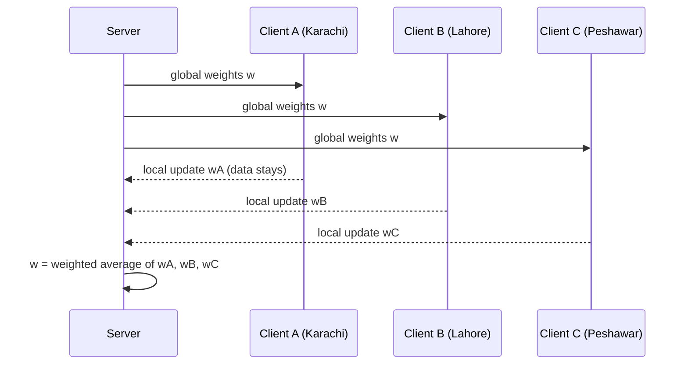
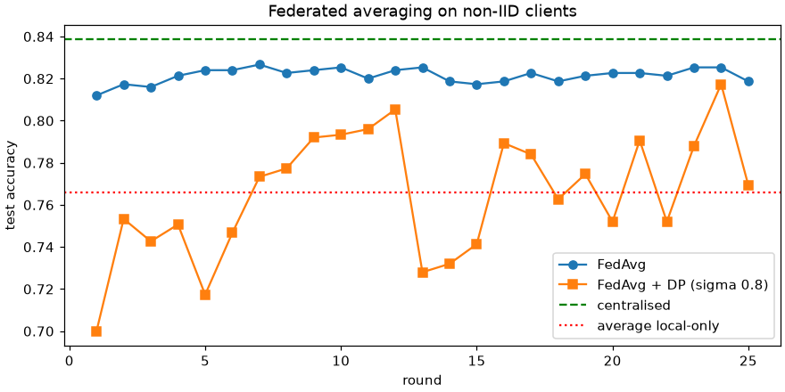

# Session 06 · Federated Learning: Privacy, Security, and Edge Computing

> **Module:** AI and ML with Python · **Term 2** · ⏱️ ~2 hours
> **You will learn:** why sending raw data to one server is often impossible, how **federated learning (FL)** trains a shared model by moving the model to the data, the **FedAvg** algorithm, what happens with **non-IID** clients, how **secure aggregation** and **differential privacy** protect updates, the cost of communication on **edge devices**, and how to simulate all of it with NumPy.

---

## 1. Move the model, not the data

Hospitals cannot share patient records, banks cannot pool customer transactions, and phones should not upload everything you type. **Federated learning** lets many clients train one model together: the server sends the current model, each client improves it on its **own private data**, and only the **model updates** go back to be averaged.

> 📒 **Analogy:** Five schools in a district want a better exam-preparation guide but are not allowed to share students' answer sheets. Each school's teachers improve the shared guide using their own students' mistakes and send back only their *edits*. The district office merges the edits into the next version. Nobody's answer sheets leave the school.





## 2. Reference tables

| Setting | Data location | Privacy | Model quality |
|---|---|---|---|
| Centralised | all data on one server | weakest | best (upper bound) |
| Local only | each client alone | strong | weak for small clients |
| Federated (FedAvg) | stays on clients | strong (+ DP/secure agg) | close to centralised |

| FedAvg step | Detail |
|---|---|
| 1. broadcast | server sends weights `w` to selected clients |
| 2. local training | each client runs *E* epochs of SGD on its data |
| 3. upload | clients send new weights (or the difference) |
| 4. aggregate | `w = Σ (n_k / n) · w_k` (weighted by client data size) |
| 5. repeat | for *R* rounds |

| Challenge | Meaning | Mitigation |
|---|---|---|
| non-IID data | clients' data look different (one bank mostly students) | more rounds, FedProx, personalisation |
| stragglers | slow phones drop out | sample a subset of clients per round |
| communication cost | model sent every round | fewer rounds, compression |
| inference attacks | updates can leak data | secure aggregation, differential privacy |
| poisoning | malicious client sends bad updates | robust aggregation (median, trimmed mean) |

| Privacy tool | Idea |
|---|---|
| secure aggregation | clients add random masks that cancel in the sum — server sees only the total |
| differential privacy | clip each update, add calibrated Gaussian noise; trades accuracy for privacy |

## 3. Worked examples

Full runnable code: [`code/examples.py`](./code/examples.py) · notebook: [`notebook.ipynb`](./notebook.ipynb) · library: [`code/fl.py`](./code/fl.py)

### Example 1 — split one dataset across clients (IID and non-IID)
```python
clients = split_clients(X, y, n_clients=5, iid=False, seed=0)
```

### Example 2 — a NumPy logistic-regression client
```python
w = local_train(w_global, Xk, yk, epochs=5, lr=0.1)
```

### Example 3 — FedAvg
```python
w, history = fedavg(clients, rounds=20, epochs=5, X_test=X_te, y_test=y_te)
```

### Example 4 — compare with centralised and local-only
```python
print(acc(central_w), acc(fed_w), [acc(local_train(zeros, Xk, yk, 100)) for Xk, yk in clients])
```

### Example 5 — secure aggregation with cancelling masks
```python
masked = secure_sum([w_a, w_b, w_c], seed=1)   # equals w_a + w_b + w_c, individual vectors hidden
```

### Example 6 — differential privacy: clip + noise
```python
w, hist = fedavg(clients, rounds=20, dp_clip=1.0, dp_sigma=0.5)
```

## 4. Common mistakes

| Mistake | Fix |
|---|---|
| Plain averaging when clients have very different sizes | Weight by `n_k / n` |
| Assuming FL alone guarantees privacy | Add secure aggregation and/or differential privacy |
| Testing only on IID splits | Real clients are non-IID — test that case |
| Too many local epochs on non-IID data (client drift) | Fewer epochs or proximal terms |
| Forgetting communication cost on phones | Count bytes per round × rounds |

## 5. Real-life coding problem 🧮

**Problem:** Five bank branches (Karachi, Lahore, Islamabad, Quetta, Peshawar) want a shared **loan-default** model but cannot share customer files. Branch sizes differ (from 150 to 1,200 customers) and their customer mix is non-IID. Simulate the data, train with FedAvg for 25 rounds, and compare test accuracy of (a) centralised, (b) each branch alone, (c) FedAvg, (d) FedAvg with differential privacy (clip 1.0, σ = 0.3). Also report the total megabytes uploaded.

<details>
<summary>💡 Full solution</summary>

```python
fed_w, _ = fedavg(clients, rounds=25, epochs=3, lr=0.2)
dp_w, _ = fedavg(clients, rounds=25, epochs=3, lr=0.2, dp_clip=1.0, dp_sigma=0.3, seed=1)
results = {"central": accuracy(central_w, X_te, y_te), "fedavg": accuracy(fed_w, X_te, y_te),
           "fedavg+DP": accuracy(dp_w, X_te, y_te),
           "local_mean": np.mean([accuracy(local_train(np.zeros(d), Xk, yk, 75, 0.2), X_te, y_te) for Xk, yk in clients])}
mb = 25 * len(clients) * fed_w.size * 8 / 1e6
```
Full file: [`code/problem_solution.py`](./code/problem_solution.py)
</details>

## 6. Practice exercises

1. Run FedAvg on IID vs non-IID splits and compare final accuracy after 10 rounds.
2. Change local epochs (1, 5, 20) on the non-IID split; what happens?
3. Replace the weighted mean with a coordinate-wise **median** and show it resists one malicious client that sends `100 × w`.
4. Plot (or print) accuracy vs DP noise σ ∈ {0, 0.5, 1, 2}.

<details>
<summary>✅ Solutions</summary>

```python
iid = fedavg(split_clients(X, y, 5, iid=True), rounds=10)[1][-1]
for e in (1, 5, 20): print(e, fedavg(clients, rounds=10, epochs=e)[1][-1])
agg = np.median(np.stack(updates), axis=0)          # robust to one 100x update
for s in (0, 0.5, 1, 2): print(s, fedavg(clients, rounds=20, dp_clip=1.0, dp_sigma=s)[1][-1])
```
File: [`code/exercises_solutions.py`](./code/exercises_solutions.py)
</details>

## 7. Quiz

1. What travels between clients and server in federated learning?
2. Write the FedAvg aggregation rule.
3. What does "non-IID" mean for clients?
4. How does secure aggregation hide individual updates?
5. What is the trade-off in differential privacy?

<details>
<summary>Answers</summary>

1. Model weights/updates — never raw data · 2. w = Σₖ (nₖ / n) · wₖ · 3. Each client's data come from a different distribution (different mix of classes/features) · 4. Clients add pairwise random masks that cancel when summed, so the server sees only the total · 5. More noise = stronger privacy but lower accuracy.
</details>

## 8. Summary

- FL trains a shared model while data stay on clients (hospitals, banks, phones).
- FedAvg = local training + data-size-weighted averaging, repeated over rounds.
- Non-IID data, stragglers, communication and attacks are the real challenges.
- Secure aggregation and differential privacy add protection on top of FL.

---
[⬅ Session 05](../Session-05-customer-segmentation/) · [Module home](../README.md) · [Session 07 ➡](../Session-07-quantum-ml/)

<sub>Original teaching material by Aseef Ahmed · not official Aptech courseware · CC BY-NC 4.0 (text) / MIT (code)</sub>
