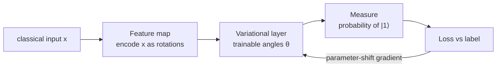
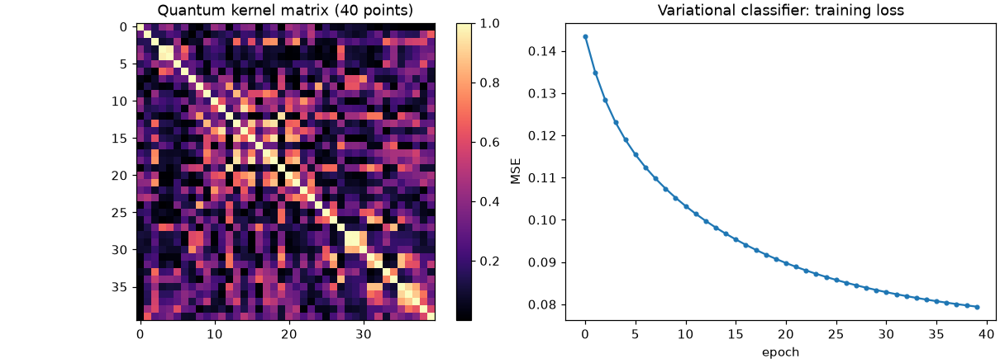

# Session 07 · Quantum Computing and Machine Learning Integration

> **Module:** AI and ML with Python · **Term 2** · ⏱️ ~2 hours
> **You will learn:** the basics of quantum computing — **qubits**, **superposition**, **entanglement**, **gates** and **measurement** — by building a tiny **state-vector simulator** in NumPy, then how quantum ideas meet ML: **quantum feature maps**, **quantum kernels** used inside a classical SVM, and a **variational quantum classifier** trained with the parameter-shift rule. We also discuss honestly where quantum ML stands today.

---

## 1. Bits, qubits and why ML people care

A classical bit is 0 or 1. A **qubit** is a vector of two complex amplitudes α|0⟩ + β|1⟩ with |α|² + |β|² = 1; measuring it gives 0 with probability |α|² and 1 with probability |β|². *n* qubits need 2ⁿ amplitudes — that exponential state space is why quantum computers might, for some problems, compute things classical machines find hard. For ML, the hope is richer **feature spaces** (quantum kernels) and new kinds of trainable models (**variational circuits**).

> 📒 **Analogy:** A coin lying on the table is a classical bit — heads or tails. A coin *spinning* on the table is like a qubit: until it falls (measurement) it is in a blend of both, and how it was spun (the gates) decides the odds. Two coins spun together so they always land the same way are "entangled".





## 2. Reference tables

| Gate | Matrix effect | Purpose |
|---|---|---|
| X | flips \|0⟩ ↔ \|1⟩ | quantum NOT |
| H (Hadamard) | \|0⟩ → (\|0⟩ + \|1⟩)/√2 | creates superposition |
| RY(θ) | rotate by θ around the Y axis | encode data / trainable parameter |
| RZ(θ) | phase rotation | encode data |
| CNOT | flips target if control is \|1⟩ | creates entanglement |

| Concept | In the simulator |
|---|---|
| state of n qubits | complex vector of length 2ⁿ |
| apply a gate | matrix–vector product (Kronecker products for multi-qubit) |
| measure | probabilities = \|amplitude\|²; sample with `rng.choice` |
| Bell state | H on qubit 0, then CNOT(0→1): only 00 or 11 appear |

| Quantum ML approach | Idea | Classical counterpart |
|---|---|---|
| quantum kernel | k(x, x′) = \|⟨φ(x)\|φ(x′)⟩\|² | kernel SVM |
| variational quantum classifier (VQC) | circuit with trainable angles, measured output = prediction | small neural network |
| quantum annealing / QAOA | optimisation problems | heuristics, solvers |

| Reality check (2026) | |
|---|---|
| hardware | noisy, tens to a few hundred useful qubits (NISQ era) |
| proven ML advantage on real business data | not yet demonstrated |
| how to practise | simulators (Qiskit, PennyLane, Cirq) — or NumPy, as here |

## 3. Worked examples

Full runnable code: [`code/examples.py`](./code/examples.py) · notebook: [`notebook.ipynb`](./notebook.ipynb) · simulator: [`code/qsim.py`](./code/qsim.py)

### Example 1 — one qubit, superposition and measurement
```python
state = apply(H, zero_state(1), target=0, n=1)
print(probabilities(state))               # [0.5, 0.5]
print(measure(state, shots=1000, seed=0))  # roughly 500 zeros, 500 ones
```

### Example 2 — entanglement: a Bell state
```python
s = apply(H, zero_state(2), 0, 2); s = cnot(s, control=0, target=1, n=2)
print(measure(s, 1000))                   # only '00' and '11'
```

### Example 3 — encode data with rotations (feature map)
```python
def feature_map(x):                       # two features → two qubits
    s = zero_state(2)
    s = apply(ry(x[0]), s, 0, 2); s = apply(ry(x[1]), s, 1, 2)
    return cnot(s, 0, 1, 2)
```

### Example 4 — a quantum kernel inside scikit-learn's SVC
```python
K_train = quantum_kernel(X_tr, X_tr); K_test = quantum_kernel(X_te, X_tr)
svc = SVC(kernel="precomputed").fit(K_train, y_tr); print(svc.score(K_test, y_te))
```

### Example 5 — a variational classifier and the parameter-shift rule
```python
grad_i = (loss(theta + shift_i) - loss(theta - shift_i)) / 2      # shift = π/2 on parameter i
```

### Example 6 — compare with a classical model
```python
print("RBF SVM:", SVC().fit(X_tr, y_tr).score(X_te, y_te))
```

## 4. Common mistakes

| Mistake | Fix |
|---|---|
| Thinking a qubit "is 0 and 1 at the same time" and stores 2 bits | It holds amplitudes; measurement gives one bit |
| Forgetting to normalise / scale inputs before angle encoding | Scale features to e.g. [0, π] |
| Believing quantum ML is already faster for everyday data | Benchmark against classical baselines — they usually win today |
| Simulating 40 qubits on a laptop | Memory is 2ⁿ complex numbers; stay small |
| Ignoring shot noise | Real hardware returns sampled counts, not exact probabilities |

## 5. Real-life coding problem 🧮

**Problem:** A research group in Islamabad wants to try a quantum kernel for a tiny **crop-health** dataset: two scaled sensor readings (leaf moisture, chlorophyll index) and a healthy/unhealthy label that follows a circular pattern. Generate 120 seeded points, encode them with the 2-qubit feature map, build the quantum kernel matrix, train `SVC(kernel="precomputed")`, and compare its test accuracy with a linear SVM and an RBF SVM. Report all three honestly.

<details>
<summary>💡 Full solution</summary>

```python
X, y = make_crop_data(120, seed=7)
Xs = MinMaxScaler((0, np.pi)).fit_transform(X)
X_tr, X_te, y_tr, y_te = train_test_split(Xs, y, test_size=0.3, random_state=0, stratify=y)
qk = SVC(kernel="precomputed").fit(quantum_kernel(X_tr, X_tr), y_tr).score(quantum_kernel(X_te, X_tr), y_te)
lin = SVC(kernel="linear").fit(X_tr, y_tr).score(X_te, y_te)
rbf = SVC(kernel="rbf").fit(X_tr, y_tr).score(X_te, y_te)
```
Full file: [`code/problem_solution.py`](./code/problem_solution.py)
</details>

## 6. Practice exercises

1. Build the 3-qubit GHZ state (H on q0, CNOT 0→1, CNOT 1→2) and show only `000` and `111` are measured.
2. Show that applying H twice returns |0⟩.
3. Compute the quantum kernel value between a point and itself — what must it be and why?
4. Train the VQC for 20 and 60 epochs and compare the training loss.

<details>
<summary>✅ Solutions</summary>

```python
s = apply(H, zero_state(3), 0, 3); s = cnot(s, 0, 1, 3); s = cnot(s, 1, 2, 3)
s = apply(H, apply(H, zero_state(1), 0, 1), 0, 1)       # back to [1, 0]
k_self = quantum_kernel(X[:1], X[:1])[0, 0]               # 1.0: a normalised state overlaps fully with itself
theta, losses = train_vqc(X_tr, y_tr, epochs=60)
```
File: [`code/exercises_solutions.py`](./code/exercises_solutions.py)
</details>

## 7. Quiz

1. How many amplitudes describe 5 qubits?
2. What does the Hadamard gate do to |0⟩?
3. What makes a Bell state "entangled"?
4. How does a quantum kernel plug into classical ML?
5. Is quantum advantage for everyday ML proven today?

<details>
<summary>Answers</summary>

1. 2⁵ = 32 · 2. Creates an equal superposition (|0⟩ + |1⟩)/√2 · 3. The qubits' outcomes are perfectly correlated and the state cannot be written as a product of single-qubit states · 4. It supplies the kernel matrix to an SVM (`kernel="precomputed"`) · 5. No — it remains an active research question; always compare with classical baselines.
</details>

## 8. Summary

- Qubits hold amplitudes; gates rotate them; measurement samples bits.
- Superposition and entanglement come from H and CNOT gates.
- Quantum kernels and variational circuits are the two main bridges to ML.
- Simulators are the right place to learn; be honest about today's limits.

---
[⬅ Session 06](../Session-06-federated-learning/) · [Module home](../README.md) · [Session 08 ➡](../Session-08-meta-learning/)

<sub>Original teaching material by Aseef Ahmed · not official Aptech courseware · CC BY-NC 4.0 (text) / MIT (code)</sub>
